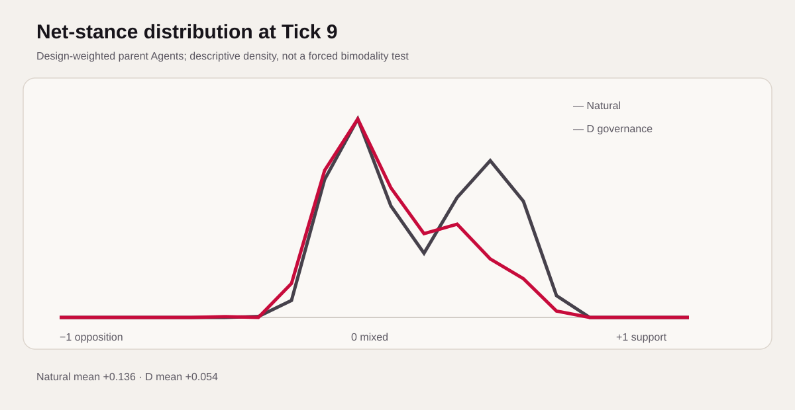

# CampusPulse ForumTwin 实验设计与结果报告

最新 Reddit Natural 运行已完成，见 §6.17：24名固定Agent、196条新共同观察及对应输出，推进到Tick 9。此前预实验与本轮数据独立保存。

## 1. 我们做了什么

CampusPulse 构建了一个由 1,000 个合成人物组成的校园论坛世界。每个人物都有稳定的性格、经历、现实处境、短期记忆以及好友和熟人关系。校园事件发生后，他们会按照各自的关注点阅读论坛，并选择发帖、回复、点赞、转发、举报、匿名表达、私聊、建群、求助或保持沉默。

论坛采用校园“小喇叭”常见的信息结构：所有人看到同一份热榜前十和最新帖子。人物关系会影响谁更愿意点开帖子、向谁私聊、是否继续跟进，但不会改变公共热榜。每次公开发言和私聊内容都由大语言模型根据人物资料与当时可见信息生成。

系统同时设置三类治理角色：负责解释规则的人、负责受理服务的人和负责跨群沟通的人。他们掌握的信息各不相同，也受到时间和资源限制。实验比较两种路径：一条让讨论自然发展，另一条允许三类治理角色根据已看到的问题发布规则说明、登记服务工单并开展跨群沟通。

## 2. 人群、数据和参数

### 2.1 数据处理

人物设计参考了校园论坛中 132,917 条帖子和 454,053 条评论。数据经过清洗和去重后，形成 582,408 条可分析文本；研究团队进一步审阅了 3,000 个具有代表性的讨论，并把其中的主题、诉求、表达方式和互动习惯扩展到 131,604 个完整讨论。由此整理出：

- 17 类常见的论坛参与方式，例如求助、核实信息、分享经验和协助沟通；
- 120 种更细的人物类型；
- 22,477 套候选人物资料；
- 1,000 个在整个实验中持续存在的合成人物；
- 每个人物保留 10 种可能的心理与行为状态，用来表示信息不足时的不确定性。

这些人物根据群体语言、常见诉求和互动规律组合，构成具有稳定差异的虚拟校园人群。

### 2.2 运行参数

| 参数 | 主实验设置 |
|---|---|
| 场景 | 暑期住宿床位分配正当性争议 |
| 对比方案 | 自然演化、动态治理 |
| 时间 | 从事件发生后的第 3 步推进至第 10 步 |
| 人口 | 1,000 个合成人物 |
| 人物状态 | 每人 10 种可能状态，共 10,000 个状态样本 |
| 人物决策 | 360 次居民决策 + 6 次治理决策 |
| 论坛入口 | 全局热榜前十 + 最新帖子 |
| 每步参与者 | 持续跟踪人物、当前讨论参与者和分层抽取的人物 |

两种方案使用相同的人物、事件和初始状态。这样，后续差异可以直接追溯到治理行动以及居民对这些行动的回应。

## 3. 三个最终项目

### 3.1 暑期住宿床位分配正当性争议：主实验

事件设定：暑期住宿床位从原计划数量缩减为 320 张，而有效申请有 536 份。初始公告说明了部分优先情形，但类别排序、同类申请者排序、材料补交、截止时间、复核责任和申诉答复仍不清楚。不同人物因需求强度、材料完整度、时间紧迫性、替代资源和服务渠道依赖不同，对同一公告形成不同理解。

动态治理方案根据公开讨论、求助队列和触达缺口，发布规则说明、登记服务工单并开展跨群沟通。居民可以接受、质疑、继续追问或忽略这些信息。

最终结果：

| 指标（第 10 个时间步） | 自然演化 | 动态治理 | 观察 |
|---|---:|---:|---|
| 公开消息 | 73 | 76 | 治理没有靠压低讨论制造改善 |
| 直接回复 | 57 | 61 | D 中讨论更集中到既有问题 |
| 讨论串 | 16 | 8 | 相近问题更集中地被讨论 |
| 主要说法 | 17 | 10 | 分散说法减少 7 个 |
| 纠错消息 | 0 | 2 | D 产生了可追溯纠错 |
| 求助积压 | 0.70 | 0 | 工单机制完成了承接 |
| 无依据说法新增速度 | 0.111 | 0 | 新的无依据说法受到抑制 |
| 跨群曝光差 | 0.911 | 0.950 | 触达不均反而扩大 |
| 群体信任 | 0.429 | 0.375 | 服务处理后，规则公平仍受到追问 |

六条治理信息中有三条收到居民直接回复或引用。居民继续追问规则说明中尚未明确的排序、补材料时限和复核入口。服务工单回答了“有没有人处理”，规则说明还需要进一步回答“为什么这样排序”。系统因此能够在措施落地前同时识别服务承接和程序解释两个环节。

### 3.2 世纪馆“幽灵预约”争议：现场运行项目

事件设定：学生在世纪馆发现羽毛球、乒乓球等场地现场有空位，但热门时段在预约系统中连续显示不可预约。论坛先出现目击帖，随后形成“有人占号”“系统释放延迟”“核销规则不透明”等竞争解释。动态治理方案可发布预约规则说明、登记异常释放工单并开展跨项目沟通。

两种方案均完整推进至第 10 个时间步。自然演化形成 108 条公开消息、103 条回复和 9 个主要说法；动态治理形成 111 条公开消息、100 条回复和 5 个主要说法，并发布 6 条治理信息。该项目完整展示系统的运行过程：创建项目、加载人物、事件进入论坛、人物轮换参与、帖子与互动增长、私聊传播、治理回应出现，以及两种方案同步演化。

### 3.3 讲座冲突事件传播：迁移案例

事件设定：校外讲者在校园讲座中被确认辱骂学生并公开道歉。论坛争议不止于“是否道歉”，还包括伤害是否被承认、责任边界、学校后续保障以及受影响学生怎样获得支持。

动态治理方案的公开消息从 167 条增至 173 条，主要说法从 22 个收敛至 4 个，群体信任提高 3.2 个百分点、担忧降低 2.6 个百分点，并形成 4 条居民直接回应治理信息的讨论链。这说明同一套人物与论坛机制也能用于不同类型的校园治理事件。

## 4. 四个维度的结论

### 4.1 论坛真实性

我们把 48 条持续至少两个时间步的模拟讨论，与 3,254 条真实校园论坛讨论进行对照。真实论坛中 70.7% 的帖子得到回复，模拟论坛为 77.1%，相差 6.4 个百分点；两边的回复数中位数都是 2。综合比较不同讨论规模后，分布差异分数为 0.005，越接近 0 表示越相似。

模拟论坛中有 11 条帖子无人回复，也有少数讨论延伸到 15 条回复，呈现出“小帖很多、长讨论较少”的结构。热榜会吸引更多注意，最新帖子和较冷内容也保留被看见的机会，因此讨论不会全部挤在同一篇帖子下。

### 4.2 人物真实性

人物每次行动前会同时看到三类信息：自己的长期性格和经历、眼前的论坛内容、上一时间步形成的担忧与信任状态。研究团队抽取 24 条发言独立检查，其中 95.8% 直接回应了人物当时看到的信息，没有出现统一套话或凭空增加事件事实的情况。

我们还让同一批 12 个人物在相同论坛内容下完成四组对照：只看论坛、加入人物档案、加入上一时间步状态、同时加入两者。完整输入使 75.0% 的人物改变主要行动，91.7% 改变情绪表达，66.7% 改变是否发起私聊。人物档案和当前状态都能明显改变他们的选择，详细结果见 4.10 节。

在 32 名多次发言的人物中，同一个人的前后表达相似度为 0.578，不同人物为 0.550。差距并不夸张，但说明人物会保留自己的提问习惯、证据偏好和表达方式，同时也会随着新信息调整判断。

### 4.3 人群异质性

系统保存了 14 个完整的人群状态快照，每个快照包含 1,000 个人物。人物会因是否直接需要床位、材料是否齐全、时间是否紧迫、是否有替代住处等条件产生不同反应。事件发生后，这些利益处境可以解释约 8%—15% 的群体状态差异。

在 122 次有效公开表达中，63 次是混合态度，52 次仍在观望，4 次明确支持，3 次明确反对。多数人选择围绕排序、补材料、复核和申诉提出具体问题。到第 9 个时间步，自然演化出现两个较明显的观点聚集区；动态治理下的意见更集中，但整体担忧更高。详细状态变化见 4.13 节。

### 4.4 治理响应

动态治理共发布 6 条信息，其中 3 条得到居民直接回复或引用。规则说明减少了新的无依据说法，服务工单把求助积压从 0.70 降到 0，管理者遗漏的问题也从 0.351 降到 0.265。

与此同时，跨群触达差距从 0.911 上升到 0.950，最终群体信任也比自然演化低 0.054。居民认可“有人开始处理”，但继续追问排序依据、补材料期限和复核入口。实验由此区分出两种治理任务：一是把问题接住，二是把规则解释清楚。前者已经改善，后者仍需加强。

### 4.5 四项表现一览

为便于阅读，下表把评估结果归纳为四个问题：论坛像不像真实讨论、人物是否前后一致、不同人是否产生不同反应、治理措施是否真的被居民接住。

| 评估问题 | 使用的数据 | 结果 | 说明 |
|---|---|---:|---|
| 论坛讨论结构是否自然 | 48 条模拟讨论串与 3,254 条真实论坛讨论串 | 有回复讨论串比例相差 6.4 个百分点 | 模拟中同时存在无人回复的小帖、普通问答和少数长讨论 |
| 同一个人物是否保持连续 | 312 次人物决策、24 条人工盲审 | 95.8% 的发言承接了眼前内容 | 人物会延续自己的提问方式、证据偏好和此前对话 |
| 不同处境的人是否出现不同反应 | 1,000 个合成人物、14 个完整状态快照 | 利益处境最多解释 14.5% 的群体状态差异 | 直接受影响者、有替代选择者和旁观者形成不同变化路径 |
| 治理信息是否进入后续讨论 | 6 条治理信息 | 3 条收到居民直接回复或引用 | 服务工单得到承接，规则说明继续受到追问，跨群通知效果有限 |

### 4.6 主实验如何一步步分叉

自然演化和动态治理在第 3 个时间步前完全相同。动态治理随后加入规则说明、服务工单和跨群通知。表中数字均为截至该时间步的累计结果。

| 时间步 | 自然演化：消息/回复 | 动态治理：消息/回复 | 自然演化：讨论串/主要说法 | 动态治理：讨论串/主要说法 | 自然演化：信任/担忧 | 动态治理：信任/担忧 |
|---:|---:|---:|---:|---:|---:|---:|
| 3 | 4 / 0 | 4 / 0 | 4 / 4 | 4 / 4 | 0.677 / 0.346 | 0.677 / 0.346 |
| 4 | 15 / 7 | 17 / 11 | 8 / 8 | 5 / 6 | 0.588 / 0.406 | 0.588 / 0.407 |
| 5 | 25 / 13 | 31 / 20 | 12 / 12 | 7 / 8 | 0.533 / 0.437 | 0.515 / 0.460 |
| 6 | 39 / 25 | 38 / 27 | 14 / 14 | 7 / 9 | 0.492 / 0.446 | 0.470 / 0.471 |
| 7 | 52 / 38 | 47 / 33 | 14 / 14 | 7 / 9 | 0.467 / 0.432 | 0.438 / 0.462 |
| 8 | 60 / 45 | 57 / 42 | 15 / 16 | 8 / 10 | 0.451 / 0.401 | 0.415 / 0.439 |
| 9 | 64 / 49 | 68 / 53 | 15 / 16 | 8 / 10 | 0.439 / 0.368 | 0.384 / 0.428 |
| 10 | 73 / 57 | 76 / 61 | 16 / 17 | 8 / 10 | 0.429 / 0.335 | 0.375 / 0.390 |

动态治理没有让讨论消失。最终它比自然演化多 3 条消息和 4 条回复，但讨论集中在 8 个讨论串和 10 个主要说法中；自然演化则分散在 16 个讨论串和 17 个主要说法中。

| 第 10 个时间步的风险 | 自然演化 | 动态治理 | 变化 | 发生了什么 |
|---|---:|---:|---:|---|
| 新的无依据说法 | 0.111 | 0.000 | -0.111 | 规则说明减少了新猜测继续增加 |
| 仍有争议的说法占比 | 0.824 | 0.800 | -0.024 | 争议略有收敛，但关键问题仍在讨论 |
| 不同群体接触信息的差距 | 0.911 | 0.950 | +0.039 | 通知仍集中在较活跃群体，边缘人群触达不足 |
| 求助积压 | 0.700 | 0.000 | -0.700 | 服务工单和回执让求助进入了明确处理流程 |
| 管理者遗漏的问题 | 0.351 | 0.265 | -0.085 | 管理者掌握了更多公开争议和求助信息 |

### 4.7 具体人物：一条连续八步的讨论轨迹

世纪馆案例中，我们跟踪了一名习惯“先问清楚再判断”的人物。系统为其保存稳定人物档案、近期经历和 10 种可能的内部状态；这 10 种状态共同描述同一个人在信息不完整时可能出现的不同反应。

| 时间步 | 他看到了什么 | 他做了什么 | 讨论怎样继续 | 当时的判断 |
|---:|---|---|---|---|
| 3 | 学生连续看到场地空着，但系统显示不可预约 | 发帖：“连续三天看到空场但显示不可约，确实值得查；不过‘内部占用’还只是猜测。有没有人记下具体日期、时段和场地？” | 下一步收到 4 条直接回复，大家开始补充日期、场号和释放时间 | 好奇、尚未确认、先收集证据 |
| 4 | 看到有人询问取消后多久释放、未到场是否自动核销 | 回复：“同一场地同时截下现场状态和小程序页面，并记录取消或过期后的时间点。” | 有人进一步追问羽毛球和乒乓球是否使用同一规则 | 开始挑战“内部占用”这一说法 |
| 5 | 看到维护、教学活动和系统未释放等多种解释 | 回复：“连续记录几个时段，再结合现场标识，才能区分维护锁场和预约未释放。” | 收到 3 条直接回复，讨论从猜测动机转向核对规则 | 保持谨慎，提出可执行核查办法 |
| 6 | 看到有人追问未签到多久自动核销 | 回复：“能否记录预约从成功、取消或过期到重新可约的时间？” | 有人要求拿实际状态记录与规则文本对照 | 对证据的要求进一步具体化 |
| 7 | 看到有人追问两个运动项目是否共用规则 | 回复：“最好按项目各找一条实际记录，看未签到后何时恢复、是否有例外。” | 本步无人直接回复，下一步继续承接相关讨论 | 从单次目击推进到项目间比较 |
| 8 | 看到规则说明与现场记录可能对不上 | 回复：“如果状态一直不释放，才更像系统或流程问题。” | 下一步有人追问具体时段 | 拒绝直接归因，继续寻找判别证据 |
| 9 | 看到两个项目的规则差异仍不清楚 | 回复：“按项目、时段各复现一次，比继续猜‘内部占用’更有区分度。” | 下一步收到 2 条直接回复，其他人开始提出记录方案 | 形成可复核的比较方法 |
| 10 | 看到别人要求给出具体时段 | 回复：“记录取消或未签到时间，再看何时恢复可约；一直不变才更像未释放。” | 讨论形成“目击—质疑—记录—判别”的完整链条 | 保持开放判断，问题已转为可检查事项 |

这名人物没有突然改变性格，也没有机械重复一句话。他在别人不断补充信息后，把最初的模糊怀疑逐步整理成可以查证的具体问题。

### 4.8 具体治理：为什么办了工单，信任仍没有立刻上升

动态治理共发布 6 条信息，包括 2 次规则说明、2 个服务工单和 2 次跨群通知。居民随后可以接受、追问、质疑或忽略。

| 治理措施 | 对外信息 | 居民的直接回应 | 说明 |
|---|---|---|---|
| 规则说明 | “床位320张、有效申请536份；类别排序、同类排序、补材料入口和截止时间仍待确认，相关标准和复核入口将在公告栏更新。” | “床位数确认了，但补材料入口、截止时间，以及三类之间和同类内部怎么排仍没看到。什么时候公布？” | 总量信息减少了部分猜测，但居民真正关心的是排序和申诉规则 |
| 服务工单 | “已登记咨询，将核对排序规则和‘通勤困难’证明口径，并在48小时内反馈。” | “收到登记回执，但现在只知道‘会核实’。能否明确反馈时间和补证明入口？” | 工单解决了“有没有人处理”，尚未回答“规则是否公平” |
| 跨群通知 | 向此前较少接触信息的人群推送规则说明和服务入口 | 两次通知均未收到直接回复或引用 | 信息送达后仍需要更合适的渠道和表达方式 |

因此，动态治理把求助积压从 0.70 降至 0，也阻止了新的无依据说法继续增加；但第 10 个时间步的信任仍比自然演化低 0.054。居民把治理信息当作新的追问对象，说明“及时回应”和“解释清楚”是两个不同环节。

### 4.9 两种方案的最终讨论结构

| 观察内容 | 自然演化 | 动态治理 | 差异 |
|---|---:|---:|---|
| 讨论串 | 16 | 8 | 动态治理把相近问题集中到共同讨论对象 |
| 主要说法 | 17 | 10 | 分散说法减少 7 个 |
| 纠错消息 | 0 | 2 | 动态治理产生了可追踪的纠错 |
| 直接回复 | 57 | 61 | 动态治理下的讨论更集中在回复与追问 |
| 点赞和转发 | 114 | 105 | 两种方案的轻量互动规模接近 |
| 私聊消息 | 67 | 68 | 公开治理没有让私下讨论消失 |
| 参与过本次模拟的人物 | 83 | 83 | 两种方案使用相同的参与人口 |



图中横轴从质疑到支持，灰线为自然演化，红线为动态治理。两条线都集中在中间区域，但自然演化出现更明显的第二个观点聚集区；动态治理则更多集中在谨慎和混合态度附近。

### 4.10 人物设定是否真的影响选择

我们固定同一批 12 个人物，让他们看到同一页论坛内容，然后依次增加人物档案和上一时间步的内部状态。完整输入包括：他平时怎样说话、当前是否直接受影响、过去如何处理不确定信息，以及此刻的担忧和信任状态。

| 提供给人物的信息 | 公开发言人数 | 私聊动作 | 出现的行动类型 | 不重复公开文本 |
|---|---:|---:|---:|---:|
| 只有论坛内容 | 2 / 12 | 1 | 3 | 2 |
| 加入人物档案 | 6 / 12 | 5 | 3 | 6 |
| 加入上一时间步状态 | 5 / 12 | 5 | 4 | 5 |
| 人物档案和状态都加入 | 10 / 12 | 11 | 4 | 10 |

与“只有论坛内容”相比，完整输入使 75.0% 的人物改变主要行动，91.7% 改变情绪表达，66.7% 改变是否私聊。比如，一名“本人申请、替代住处少、材料不齐”的人物原本选择沉默；加入完整处境后，他公开追问排序和补材料期限，同时私聊熟人核对标准与备用住处。

### 4.11 论坛讨论规模与真实数据对照

真实侧使用 3,254 条论坛讨论，模拟侧使用 48 条至少持续两个时间步的讨论。对照重点是“一篇帖子通常会有多少回复”。

| 回复数量 | 真实论坛讨论 | 真实占比 | 模拟讨论 | 模拟占比 |
|---|---:|---:|---:|---:|
| 0 | 953 | 29.3% | 11 | 22.9% |
| 1–2 | 1,096 | 33.7% | 14 | 29.2% |
| 3–9 | 915 | 28.1% | 18 | 37.5% |
| 10 条以上 | 290 | 8.9% | 5 | 10.4% |

| 统计内容 | 真实论坛 | 模拟论坛 |
|---|---:|---:|
| 有回复的讨论占比 | 70.7% | 77.1% |
| 回复数中位数 | 2 | 2 |
| 90% 的讨论不超过 | 9 条回复 | 约 9–10 条回复 |
| 分布差异分数 | — | 0.005 |

分布差异分数越接近 0，表示两种分布越接近。模拟中同样存在大量短讨论和少数长讨论，没有把所有帖子都推成相似规模。

### 4.12 另一类事件中的表现

系统还模拟了讲座冲突事件。这个案例关注伤害是否得到承认、责任怎样说明，以及受影响学生能否获得后续支持。

| 第 10 个时间步 | 自然演化 | 动态治理 | 变化 |
|---|---:|---:|---:|
| 公开消息 | 167 | 173 | +6 |
| 回复 | 158 | 161 | +3 |
| 主要说法 | 22 | 4 | -18 |
| 公开参与人数 | 48 | 54 | +6 |
| 群体信任 | 0.392 | 0.424 | +0.032 |
| 群体满意 | 0.100 | 0.118 | +0.018 |

动态治理让更多人围绕较少的核心问题继续讨论。该案例中的群体信任和满意度有所回升，说明治理措施的效果会随事件性质和居民诉求变化。

### 4.13 人群状态怎样计算

每个人物都有 10 种可能的内部状态，用来表达同一个人在信息不完整时可能出现的不同反应。这些状态围绕注意力、担忧、信任、满意、支持、质疑和证据接受等方面变化。统计时先把同一个人的 10 种状态合并，再汇总 1,000 个人物。

| 群体状态 | 事件前 | 第 3 个时间步 | 自然演化第 9 步 | 动态治理第 9 步 |
|---|---:|---:|---:|---:|
| 信任：平均值 ± 人群差异 | 0.786 ± 0.104 | 0.677 ± 0.084 | 0.439 ± 0.154 | 0.384 ± 0.130 |
| 担忧：平均值 ± 人群差异 | 0.300 ± 0.043 | 0.346 ± 0.051 | 0.368 ± 0.197 | 0.428 ± 0.182 |
| 综合立场：平均值 ± 人群差异 | 0.000 ± 0.000 | 0.309 ± 0.047 | 0.136 ± 0.217 | 0.054 ± 0.187 |
| 可辨认的观点聚集区 | 1 | 1 | 2 | 1 |

事件发生后，人物之间的担忧和立场差异明显扩大。自然演化到第 9 步形成两个较明显的观点聚集区；动态治理下的意见更集中，但担忧仍然较高。

### 4.14 主要结论

实验说明，CampusPulse 可以把同一事件放入两条平行演化路径，观察不同人物怎样阅读、发言、私聊、质疑和回应治理信息。住宿案例中，规则说明减少了新的无依据说法，服务工单清空了求助积压；居民仍继续追问排序、材料补交和复核入口，跨群通知也没有充分触达边缘人群。系统因此能够在政策发布前同时呈现治理措施的效果和仍待解决的问题。

## 5. 实验复现方法

评委可从系统工作台完成以下过程。世纪馆案例提供一段完整的逐步演化记录，住宿和讲座案例提供方案对比结果。

| 步骤 | 操作 | 页面上可以观察的内容 |
|---:|---|---|
| 1 | 创建推演项目，选择校园公共资源与服务治理 | 系统载入固定的 1,000 个人物及其关系、经历和利益处境 |
| 2 | 填写事件，例如“世纪馆现场有空场，但热门时段持续无法预约” | 事件进入校园论坛，形成最初帖子和不同解释 |
| 3 | 选择自然演化与动态治理两种方案 | 两条路径共享同一初始人口和事件 |
| 4 | 设定 10 个时间步并启动 | 每一步更新帖子、回复、点赞、私聊、群聊和人物状态 |
| 5 | 在第 5 个时间步观察治理介入 | 可看到规则说明、服务工单、跨群通知及居民回应 |
| 6 | 播放到第 10 个时间步 | 比较讨论结构、主要说法、群体状态和服务积压 |
| 7 | 打开人物跟踪 | 查看同一人物当步看到的信息、采取的行动、别人回应及后续行为 |

### 5.1 主实验参数

| 参数 | 设置 |
|---|---|
| 合成人物 | 1,000 人 |
| 人物状态 | 每人 10 种可能状态，共 10,000 个状态样本 |
| 对比方案 | 自然演化、动态治理 |
| 实验长度 | 第 3 至第 10 个时间步 |
| 居民决策 | 360 次大语言模型调用 |
| 治理决策 | 6 次大语言模型调用 |
| 公共论坛 | 全体人物共享热榜前十和最新帖 |
| 治理角色 | 规则责任方、服务承接方、社区沟通方 |
| 治理措施 | 规则说明、服务工单、跨群通知 |

### 5.2 指标解释

| 指标 | 含义 |
|---|---|
| 讨论串 | 从一篇主帖开始形成的完整回复链 |
| 主要说法 | 论坛中可以被支持、质疑或纠正的核心观点 |
| 直接承接 | 居民直接回复或引用某条治理信息 |
| 群体信任 | 人物对当前治理过程可信程度的综合状态 |
| 群体担忧 | 人物对事件风险和自身处境的综合关注程度 |
| 求助积压 | 已提出但尚未获得明确处理回执的求助比例 |
| 跨群触达差距 | 不同人物群体接触关键信息机会的差异 |

## 6 Reddit 医疗与教育免费议题的主结果和消融

本节独立记录新场景，和前面的校园案例不作数值横向比较。议题为“医疗和教育是否应当免费”，固定世界包含 24 名合成人物和 240 个状态粒子。自然演化和治理分支共享初始人物与事件，运行至第 6 个时间步，共有 110 条去重居民决策和 6 条治理决策。居民模型为 gpt-6-luna，外部模型评审为 gpt-5.4-mini。以下区分真实生成主实验、固定发言的粒子更新消融和预测特征消融；后两项均新增模型调用 0 次。

### 6.1 多维度主结果

| 维度 | 指标 | 自然演化 | 治理分支 | 解释 |
|---|---|---:|---:|---|
| 论坛结构 | 居民公开回复 | 58 | 54 | 两分支各自包含共享前期记录，跨分支不能直接相加 |
| 论坛结构 | 治理公开消息 | 0 | 5 | 治理分支总公开消息 59 条 |
| 论坛结构 | 回复深度至少 3 的占比 | 62.07% | 40.68% | 有多层对话；分支分母为各自全部公开消息 |
| 论坛结构 | 消息长度中位数，英文单词 | 86.5 | 82.0 | 自然分支和治理分支的表达长度相近 |
| 论坛结构 | 完全重复公开消息 | 0 | 0 | 完全重复为零不代表语义不雷同 |
| 微观人物 | 上下文承接率 | 合并 104/105，99.05% | 合并统计 | 外部模型盲评，按共享决策去重 |
| 微观人物 | Profile 一致率 | 合并 104/104，100% | 合并统计 | 表明未检出明显冲突，不等于不同人物可辨识 |
| 微观人物 | 无依据事实率 | 合并 0/104，0% | 合并统计 | 在本次可判定样本中未检出 |
| 微观人物 | 前序状态与文本立场吻合率 | 合并 27/103，26.21% | 合并统计 | 原始实际生成输入对应的状态；偏低 |
| 微观人物 | 去重后人物内风格余弦相似度 | 0.9296 | 0.9273 | 人物内相似度高，需要同时检查人物间相似度 |
| 群体异质性 | 人物间风格余弦相似度 | 0.9287 | 0.9232 | 和人物内几乎一样，人物风格区分不足 |
| 群体异质性 | 12 维人物状态有效秩 | 8.815 | 8.432 | 状态未退化为单一方向，但不直接证明语言异质性 |
| 群体异质性 | 净立场均值 | 0.0645 | 0.0757 | 净立场为支持减反对，不是公开文本标签 |
| 群体异质性 | 净立场标准差 | 0.0984 | 0.1183 | 治理分支离散程度更大，不能据此判定更好 |
| 群体异质性 | 净立场 KDE 峰数 | 1 | 2 | 治理分支第二峰显著度约 6.6%，不足以单独支持强极化结论 |
| 群体异质性 | 语义簇状态解释量 R² | 0.0496 | 0.1302 | 对应置换 p=0.765/0.455，均未检出显著关联 |
| 治理响应 | 到期治理对象具有后续观察时间步 | 不适用 | 5/5 | 观察窗口完整，但不等于治理有效 |
| 治理响应 | 居民直接回复治理消息 | 0 | 1 | 治理内容的直接承接偏少 |
| 治理响应 | Claim、求助、服务回执 | 均为 0 | 均为 0 | 相关纠错率、服务闭环率缺少分母，不能填成 100% |

前序状态吻合率的按人物聚类 Bootstrap 95% 区间为 13.63%–39.62%。盲评文本中 88 条支持、14 条中立或混合、1 条反对，表达类别高度偏斜。将所有文本预测为支持的简单参照准确率为 85.44%；这是多数类参照，不是 Belief Engine 或 Generative Agents 基线实验。

本场景采用公开 CMV 讨论，私聊未启用。利益组标签未提供，因此利益组 R² 留空，不能将已有语义簇替换成利益组。

### 6.2 固定发言的粒子更新消融

固定原始人物、发言、事件和外生随机数，重新计算立场滤波。非立场状态路径保持在原始观测路径上，因此本表评价更新机制对固定发言的跟踪效果，不评价删掉组件后 LLM 会生成什么文本。所有前序比较使用相同 103 条可判定样本和冻结中立半径；决策后指标单列为探索性内部自洽。

| 更新条件 | 前序状态吻合率 | 决策后自洽率 | 相对旧滤波的前序改善 |
|---|---:|---:|---:|
| 旧滤波，读取结构化自报立场 | 26.21% | 29.13% | 参照 |
| 修正方向似然，读取结构化自报立场 | 38.83% | 47.57% | +12.62 个百分点 |
| 修正方向似然，读取前序盲评文本立场 | 52.43% | 88.35% | +26.21 个百分点 |
| 同上，去掉重采样扰动核 | 52.43% | 88.35% | +26.21 个百分点 |
| 不同化发言 | 19.42% | 20.39% | −6.80 个百分点 |

修正结构化滤波相对旧滤波的配对改善 95% 区间为 3.95–21.01 个百分点；盲评文本立场条件为 14.29–36.45 个百分点。盲评文本立场条件是诊断条件：它使用已经获得的评审标签重放先前时间步，没有在原主实验中实时运行。重采样扰动核开关在本样本上未改变分箱后的吻合率，不能宣称该组件已经取得优越性。

首次观察的 35 条表达吻合率在盲评诊断中为 17.14%；已有观察历史的 68 条为 70.59%。主要困难集中于缺少事件相关证据的初始状态，以及自报立场和文本表达的不一致。103 条中自报立场与文本盲评仅 36 条一致，59 条自报混合或中立而文本被评为支持。这里的“支持”针对整个事件命题，不是对直接回复对象的赞同。

### 6.3 同场景预测特征消融

沿用项目的岭分类器，固定正则强度，按人物分组进行五折交叉验证。同一人物不会同时进入训练集与测试集。输入仅包含当前可见论坛上下文、固定人物资料、实际上一时间步状态，未将当前生成文本或标签用作特征。该实验回顾性预测已有结果；它不是重新生成四种条件，也不是按时间留出的未来预测。

| 预测目标 | 指标 | 纯上下文 | 上下文＋Profile | 上下文＋前序状态 | 完整特征 |
|---|---|---:|---:|---:|---:|
| 盲评文本立场，103 条 | 对数损失，越低越好 | 0.7811 | 0.7646 | 0.8004 | 0.8028 |
| 盲评文本立场，103 条 | 准确率 | 84.47% | 83.50% | 80.58% | 81.55% |
| 盲评文本立场，103 条 | 宏平均召回率 | 32.95% | 32.58% | 31.44% | 31.82% |
| 自报立场，110 条 | 对数损失，越低越好 | 1.1805 | 1.1726 | 1.1702 | 1.1540 |
| 自报立场，110 条 | 准确率 | 58.18% | 52.73% | 53.64% | 57.27% |
| 公开动作，110 条 | 对数损失，越低越好 | 0.4297 | 0.4293 | 0.4292 | 0.4305 |
| 公开动作，110 条 | 准确率 | 92.73% | 92.73% | 92.73% | 92.73% |

主要目标“盲评文本立场”未显示完整特征收益：完整模型相对纯上下文的对数损失改善为 −0.02165，95% 区间 −0.06666–0.02523。自报立场的联合特征改善为 0.02651，区间 0.00200–0.05491，但准确率没有提高，且自报标签与文本冲突明显，因此只作辅助结果。公开动作包含 102 条回复、8 条阅读，四组都以多数类为主；92.73% 不能解释为准确学到了人物行为差异。反对文本仅 1 条，少数类别泛化评价不稳定。

### 6.4 具体问题和优化方向

| 问题 | 已确认的证据 | 原因判断 | 下一步优先改动 |
|---|---|---|---|
| 前序状态吻合偏低 | 原始 26.21%；方向滤波修复后 38.83% | 已确认旧似然和自报文本错位；初始事件立场缺乏直接证据 | 新生成使用已修复的命题保留、方向滤波和 belief simplex；分开编码命题立场与回复对象赞同，不用无关历史强行填事件立场 |
| 人物风格难以区分 | 人物内与人物间余弦仅差约 0.0009/0.0041 | 推测任务话语和模型默认风格压过人物差异；高风格一致率本身不能定位原因 | 从现有历史提炼每个人稳定的争论方式、常用证据和妥协条件；保持人物跨事件固定，以少量配对生成检验，不靠强制对立标签 |
| 群体差异不显著 | 语义簇 R² 的 p 为 0.765/0.455 | 小样本和主题簇不等于该议题利益组；具体因素贡献尚未隔离 | 检查历史是否支持该议题的权衡差异；将经历史支持的人物价值取舍和合成事件利益分开记录；不为了显著性重分群 |
| 论坛动作过于单一 | 110 条中 102 回复、8 阅读 | 推测逐条回应任务压过注意力和行动选择 | 检查真实输入是否鼓励逐条答题；先判断打开、阅读和行动需求，再决定发言，同时保留阅读和沉默的正常收益 |
| 治理承接弱 | 5 条治理公开信息仅 1 条直接回复 | 当前议题是宽泛价值辩论，服务工单和纠错机制未必适合；触达与相关性尚需逐槽核验 | 审计治理消息是否实际进入目标人物可见输入；同一议题内采用预算说明、覆盖范围、申诉和可追问的权衡证据，避免套校园服务流程 |
| 扰动核优势未证实 | 开关核的吻合率完全相同 | 当前条件与样本对该指标不敏感 | 免费补看粒子 ESS、方差保持和退化次数；不要求所有组件都提高同一个准确率 |

这里没有执行真正的 Profile 删除后重新生成、单粒子重新生成或跨方法 baseline，因此相应论文对比列应标记为未运行。固定文本可重算更新规则和状态统计，但不能提供新文本的上下文承接率、事实率或人物风格。

### 6.5 数据位置和复现

本节数据位于 `data/private/reddit/cmv/runs/cmv-run-da2377c860a41aa41605/`。`paper-metrics.private.json` 保存真实主实验指标；`offline-particle-panel.private.json` 保存五组滤波结果及完整状态文件索引；`offline-feature-panel.private.json` 保存四组预测特征结果和人物分组。

在项目目录设置 `PYTHONPATH=src` 后运行：

```text
python scripts/audit_reddit_cmv_pilot.py --paper-run-dir data/private/reddit/cmv/runs/cmv-run-da2377c860a41aa41605 --offline-particle-panel
python scripts/audit_reddit_cmv_pilot.py --paper-run-dir data/private/reddit/cmv/runs/cmv-run-da2377c860a41aa41605 --offline-feature-panel
```

以上两个命令不发送 Provider 请求，不覆盖原始生成文本和原始检查点。

### 6.6 按对比实验文档排列的数据面板

完整面板位于 [Reddit 场景指标数据面板](data/private/reddit/cmv/runs/cmv-run-da2377c860a41aa41605/paper-data-panels.private.md)。它依次包含维度二横向表、消融 A 基础一致性、B 行为分布、C 条件识别，以及维度三净立场、宏观结构和五项连续状态表。保存的状态切片为初始 Tick 0、中段 Tick 3、实际终点 Tick 6，所有群体统计均以 24 名父人物为单位。

按照对比实验文档的独立固定 ±0.05 决策后口径，从原始检查点重算得到 41/103，即 39.81%。此前使用前序中立半径的 33.98% 保留为旧口径诊断，二者不能混用。前序吻合率仍为 27/103，即 26.21%，前序半径在本场景前序状态上冻结，不继承校园场景数值。

面板可免费重新导出：

```text
python scripts/audit_reddit_cmv_pilot.py --paper-run-dir data/private/reddit/cmv/runs/cmv-run-da2377c860a41aa41605 --paper-data-panels
```

### 6.7 四组自然演化输入消融（已授权续跑）

旧主实验的实际终点为 Tick 6。新增实验从共同 Tick 0 初态出发，运行到 Tick 9，仅使用自然演化分支，比较完整人物与状态输入、纯上下文、仅人物 Profile、仅粒子状态四种条件。固定 24 人世界，每时间步随机激活相同的 10 人；四组共 360 个居民槽位，不调用治理主体。每组独立生成讨论和记忆，下一轮读取本组此前的内容。

四组采用共同的公开论坛机制、输出合同和参与规则。去掉 Profile 的条件同时移除历史人物资料及人物衍生的行动建议；去掉状态的条件不向 LLM 提供粒子均值、分位数或状态摘要。所有组保留自己的模拟记忆。无状态输入组仍保存后台粒子状态用于诊断，因此该对比检验的是**人物与状态输入约束的作用**。既有基于 Profile 的阅读机制在四组中固定，这不是移除全部人格相关机制的实验。

使用 gpt-6-luna、关闭思考，最多 720 次请求、2,000,000 Token，并在每个时间步保存实际输入、输出、帖子、记忆和完整粒子检查点。新结果位于 `data/private/reddit/cmv/input-ablation-natural-t9/`，分组子目录为 `full`、`context_only`、`profile_only` 和 `state_only`。`progress.private.json` 保存当前完成轮次及调用用量；旧实验数据保持原样。

运行入口为 `scripts/run_reddit_cmv_input_ablation.py`。不带 `--run` 只验证冻结计划；带 `--run --until-tick 9` 按同一计划继续已提交的进度。密钥通过进程环境变量 `TIANTOKEN_API_KEY` 提供。出现 unknown 或未解决的在途调用时，入口拒绝自动续跑。四组结束后再计算实际统计结果，本节不预先宣称消融优劣。

首批实际执行了 35 次请求：29 次有效合同、5 次已结算格式失败、1 次 unknown。Provider 已报告用量为 160,420 Token，unknown 另保留 33,784 Token 风险额度。完整输入与纯上下文已分别提交 Tick 1；仅 Profile 已缓存 9 个有效槽位，最后一个请求结果未知，该组 Tick 1 尚未提交；仅状态尚未发送。已成功的槽位、原始实际输入和检查点都已落盘，不需要重复付费生成。unknown attempt 为 `ylva_b92e4324d6148b9cda6889b0`，暂停等待是否放弃其迟到结果并补发一次的明确处理决定。此次尚未完成 Tick 9，不能作为完整消融结论。

用户随后明确允许放弃该请求迟到结果并补发一次。补发已返回，经过原计划允许的一次格式修复后通过合同，仅 Profile 的 Tick 1 已提交，累计 37 次请求、167,055 个已报告 Token。运行已恢复，继续四组到 Tick 9。未知原请求及其风险计费记录保留在账本中，其迟到结果永久排除；成功缓存没有重复调用。`unknown-resolution.private.json` 和 `replacement-format-repair.private.json` 保存精确处理依据，`continuation-runtime.private.json` 记录续跑入口修复，模拟输入和初始状态保持冻结。

### 6.8 修正版状态观测与四组接续实验（进行中）

旧 Reddit 数据独立重算的决策后自洽率仍为 41/103（39.81%）。主要不一致包括：59 条自报 mixed 的发言被文本盲评判为支持；88 条支持表达中，41 条更新后净立场仍处于 ±0.05 中立区间。修正应针对测量链条，而不改分母或将状态直接写成标签。

修正版新增 `reddit/expression_observer.py`：每轮将十人的实际公开文本和事件命题作为匿名批次发送给语义观测模型。观测模型不读取 Profile、粒子状态、自报立场、条件或分支，返回表达立场、置信度和语义依据。置信度低于 0.60、空文本或无法判定立场时，不增加方向证据。有效方向观测进入既有 directional-v2 粒子似然更新；发言、自报标签与测量标签分别保存，不直接将后验覆盖成测量结果。

四组统一澄清命题立场定义：附带执行条件的支持仍为支持，mixed 指实际持有相互竞争的立场，而不是礼貌或提到权衡。此规则不指定期望的立场方向。

旧协议因未知结果和格式额度耗尽未完成全部组第二轮。修正版取四组共同已提交的 Tick 1 为固定预热，复用 40 个真实槽位，从 Tick 2 独立运行到 Tick 9，共 320 个新居民槽位及 32 个语义观测批次。主消融只比较修正版 Tick 2–9；旧协议后来生成的数据单独保留，不混入新结果。旧 unknown 不在新运行中替代，其迟到结果不接收。

新目录为 `data/private/reddit/cmv/input-ablation-natural-t9-corrected/`，入口为 `scripts/run_reddit_cmv_corrected_ablation.py`。新账本最多 1,600 请求、5,000,000 Token，连同旧已报告与风险用量不超过 6,000,000 Token；请求等待上限 240 秒，串行调用，每槽最多 3 次已结算格式修复，新 unknown 仍停止。32 项相关测试通过，首批已启动。最终效果尚待运行完成验证。用于同化的语义观测标签不能同时冒充独立评估真值。

首批十个居民输出已缓存。语义观测适配先发现遗漏 `acquire` 所需的 `prompt_sha256`，随后发现现有账本只接受 dataclass 决策而不接受普通字典；两项已修复，并补充调用签名、决策持久化和缓存再验证测试，相关测试累计 33 项通过。后者发生于观测请求返回后、结算前，输出未能持久保存，故将 `ylva_044cc5040db39bb7856e38e5` 保守结算为 unknown，风险额度 19,444 Token，不能记为已成功或无计费。当前运行暂停，未重复发送该观测请求；十个居民输出继续保留，可在获准处理该观测调用后复用。

用户随后授权此类运行自动处理未知结果并续跑。入口现已实现有界自动接续：同一 Prompt 最多两次 unknown 替代、当前运行最多八个 unknown、监督器最多六次重启；所有替代均绑定原请求，迟到结果永久排除，原风险用量与替代实际用量同时保留。成功缓存和已提交时间步直接复用，代码错误及预算耗尽停止，不进入付费重试循环。相关恢复、运行与观测测试共 37 项通过。

修正版完整输入与纯上下文两组已提交 Tick 2，其余两组继续执行。完整输入首批十条同化后状态方向与本轮语义观测方向一致（10/10）；这属于内部测量链诊断，最终自洽率须使用另外的盲评，并在四组完成后统一计算。旧结果 41/103 保持不变。最新进度、逐轮耗时、实际输入输出和检查点保存在上述修正版目录。

### 6.9 四组 Tick 9 完成结果与后续实验选择（2026-10-02）

四组均已完成 Tick 9。每组比较 Tick 2–9 的 80 个居民决策，覆盖固定世界全部 24 名 Agent；Tick 1 的 40 个复用输出作为预热，不纳入本表。新运行完成 320 个居民槽位和 32 个匿名表达观测批次，累计 405 次请求，包括 352 次成功、50 次格式失败、3 次未知结果。已报告 Token 为 2,041,573，未知结果另保留 106,476 Token 风险额度，在途预留为零。重启后的计时不代表全程耗时。

以下是免费核验得到的**内部状态跟踪诊断**，表达标签来自参与同化的语义观测模型，并非新的独立盲评。前序与决策后均使用固定净立场 ±0.05 中立区间；旧表前序采用另行校准的中立半径，样本和测量器也不同，不能将两表变化解释为受控改善幅度。无状态输入组仍保存影子粒子，表中的状态统计不代表该组 LLM 读取了粒子。

| 输入条件 | 前序状态与表达方向吻合 | 同化后状态与表达方向吻合 | 始终预测支持的参照 | 实际公开动作 |
|---|---:|---:|---:|---|
| 完整 Profile＋状态 | 64/79，81.01% | 79/79，100.00% | 100.00% | 80 次回复 |
| 纯上下文 | 59/80，73.75% | 74/80，92.50% | 98.75% | 80 次回复 |
| 仅 Profile | 59/77，76.62% | 75/77，97.40% | 100.00% | 80 次回复 |
| 仅状态 | 62/80，77.50% | 78/80，97.50% | 100.00% | 80 次回复 |

完整模型的 80 条表达中，79 条被观测为支持，1 条不足以判断；纯上下文为 79 条支持、1 条明确不确定；仅 Profile 为 77 条支持、3 条不足以判断；仅状态为 80 条支持。完整模型自报标签与可判定文本观测一致的为 59/79，仍存在自报与文本差异。首个修正版观测前的吻合为 37.50%，已经有修正版表达观察历史的为 100.00%；后半程 Tick 6–9 为 97.50%。这种随历史收敛的现象表明状态能追踪稳定的支持表达，但不能证明它能预测观点转变，也未优于多数类参照。

完整模型按人物聚类 Bootstrap 的前序吻合 95% 区间为 72.73%–87.81%，纯上下文为 63.24%–82.29%。这些是各组描述区间，不是组间配对差异的显著性检验。后续独立评估应统一命题的完整范围，保留“不足以判断”，避免将回复对象赞同与整个命题支持混为一谈。

人物内／人物间风格余弦相似度分别为：完整模型 0.93244／0.93254，纯上下文 0.94338／0.94337，仅 Profile 0.93221／0.93171，仅状态 0.94243／0.94280。本项按既有字符 n-gram 方法计算，包含预热轮；尚未显示清楚的人物风格区分。修正版正式轮完全重复文本分别为 0、0、0、1 条。当前结果的问题是方向与动作过于单一，而不是没有足够的输出条数。

**实验决策：暂不扩大同一轨迹的生成预算。** 每组已有 80 槽，增加同类回复不足以解决多数类偏斜。下一阶段优先完成以下验证：

1. 对已保存的匿名案例做统一口径的独立文本评估，评估时隐藏状态、自报标签、输入条件与同化标签；重新检查命题整体范围和上下文承接。320 条实际表达和上下文已保存为待评材料，本次统计未新增 Provider 调用。
2. 免费从已有轨迹整理冷启动、已观察历史和后半程统计，保留完整分母、人物聚类区间和多数类参照；状态维度另报告概率预测与不确定性，而非只强调更新后吻合。
3. 若需新的付费实验，先设计小规模、共享人物的“有限资源分配＋时间可见证据变化”测试。事件前人格保持固定，将领域偏好与情景约束分开；用后续行为检验状态对变化的追踪，加入静态状态和无状态参照。证据和变化须在生成前冻结，不按正式结果安排立场方向。
4. 先验证上述变化下的概率预测、校准与人物差异，再决定扩到更多人物或种子。与外部 baseline 比较时采用相同模型、输入可见性、输出上限和评估器；当前四组是输入消融，不替代三个外部 baseline。

可复现入口（不调用模型）：

```text
python scripts/audit_reddit_cmv_pilot.py --corrected-ablation-dir data/private/reddit/cmv/input-ablation-natural-t9-corrected
```

该命令验证检查点与实际输入／输出面板，写出 `offline-results.private.json`、逐条诊断 `offline-alignment-records.private.json` 和待盲评材料 `independent-review-cases.private.json`。相关审计、恢复、观测及运行测试共 40 项通过。

### 6.10 100% 内部吻合的进一步核验与小规模动态验证

完整组 79 条可判定表达的同化后净立场均超过 0.05，最小为 0.0631，中位数为 0.2571，最大为 0.5411。固定方向分箱确实得到 79/79，但它不是 100% 的置信度，也不是对下一轮表达的预测准确率。同一数据若查看事先列出的阈值敏感性，净立场超过 0.10 的为 73/79，超过 0.20 的为 57/79。这些阈值仅用于诊断，不替换原正式口径或选择最好看的结果。

本助手先在隐藏条件、Agent 身份、粒子状态、自报标签与同化标签的情况下，按固定随机种子抽取 8 条匿名表达做本地命题范围检查。5 条明确支持医疗和教育公共筹资，3 条只讨论医疗临床优先级、疼痛测量或支付能力，不能确定其教育立场。冻结本地判断后关联账本，发现这 3 条都被原观测器判为整体支持。因此，原观测器存在将局部讨论过度推断为完整命题立场的问题。这是 8 条本地助手抽查，不是人类评审，也不是 320 条的完整独立成绩；其结果保存在 `local-stance-spotcheck.private.json`。

后续表达观测新增可选 `whole_proposition_v2` 范围：逐条检查整个命题，医疗单一子议题不能填补未表达的教育立场，无法判定时保留不足以判断，不追加支持／反对方向证据。旧观测模式默认保留，旧输出与检查点未重写。独立评估同时准备输出有效标签覆盖率，防止通过排除难判文本制造高吻合率。

不同模型的完整复核入口已经实现，采用 gpt-5.4-mini、40 个匿名批次、最多 100 次请求和 400,000 Token，复用既有授权账本、成功缓存和有界未知结果接续。评审仅读取事件命题、实际表达和当时可见上下文，不读取 Profile、粒子状态、自报或同化标签。核对发送字段后已实际尝试首批，三次请求均返回已结算 HTTP 429，达到有界重试上限并停止；没有获得评审结果，没有未知结果，账本报告 Token 为零。实际收费仍以网关账单为准。外部最终评估尚未完成。

小规模动态验证已准备：在原固定 24 人世界中按语义簇与活动层选取 12 人，保持人物、初始 240 粒子、事件命题和三组激活面板固定。三轮依次引入明确标记的假设条件：初始服务预算可覆盖预计费用；费用预估上升产生资源缺口；修正估计且获得仅覆盖首年的临时补助。以上是合成反事实压力测试，不是 Reddit 历史事实或真实政策效果。模型可以改变或保持意见，方案不规定结果方向。

三组为动态状态、冻结初始状态、移除状态输入（保留 Profile）。各组保留独立论坛与记忆；静态组仅冻结传给 LLM 的状态视图，运行时影子状态仍正常更新和保存，输入记录明确标注状态值来源于 Tick 0。公开帖子继续只能由 LLM／真实 trace 产生。计划为 108 个居民槽位、9 个观测批次，单独上限 1,000,000 Token，并受前面整个任务 6,000,000 Token 累计上限约束。当前尚未启动付费生成。

零网络验证已执行全部 108 个静默合同槽位，三组均提交并恢复到第三轮；检查了增量情景条件的时间可见性、无状态组无泄漏、静态视图来源和检查点一致性。该夹具不生成公开语言，不作为模型表现证据。相关单元测试共 43 项通过。

复现入口：

```text
# 零网络执行与恢复测试
python scripts/run_reddit_cmv_corrected_ablation.py --dynamic-fixture
# 只准备外部复核，不发送任何内容
python scripts/audit_reddit_cmv_pilot.py --corrected-ablation-dir data/private/reddit/cmv/input-ablation-natural-t9-corrected --independent-ablation-review
```

动态计划及测试结果位于 `data/private/reddit/cmv/dynamic-state-comparison/`。付费启动被执行环境拦在发送前，当前动态实验新增请求为零，等待对具体外发字段的确认。人物编号为 CMV-A01 等合成编号，渲染输入的凭据、联系方式与路径扫描零命中。下一步先确认整体命题标签的独立质量，再使用小规模动态测试检查前序预测、概率与不确定性、信息更新承接及人物差异；若三组仍只有同质化支持回复，不扩大预算。

### 6.11 限流处理与动态实验接续（2026-10-02）

用户确认外发字段并授权继续后，在原复核账本内增加三次有界尝试，间隔至少两分钟，仍全部返回 HTTP 429。累计六次复核请求均为已结算失败，报告 Token 为零，没有生成独立评审标签。一次不发送 Prompt 的只读模型列表检查返回 HTTP 200，列出了 gpt-5.4-mini 和 gpt-6-luna；这说明两款模型在网关列表中存在，但不保证对应生成通道或账户配额可用。复核通道已停止重复请求，实际费用以网关账单为准。

动态实验已开始真实调用 gpt-6-luna，并获得部分有效输出。首批同时遇到格式修复耗尽和一次未知结果；有效输出保存到原缓存，未知结果保留风险额度，不将失败输出当作完成决策。接续仅修改运行恢复机制：串行失败立即停止后续派发、在原预算内有界修复已结算格式失败、按既有授权有界处理未知结果。人物、情景、模型、激活面板、原始计划身份与已提交缓存均保持不变，恢复代码变更另行记录。

所有新请求串行发送，起始间隔至少 15 秒；遇到 429 至少冷却 120 秒，并采用服务端 Retry-After 指定的有限等待。每次 HTTP 请求单独结算、计数，成功缓存不会重新付费调用。动态账本仍为最多 260 次请求、1,000,000 Token，整个任务累计上限仍为 6,000,000 Token。该实验随后达到未知请求恢复上限而停止：三组均提交到第二轮，第三轮仅有部分缓存，未构成完整结果。

停止时核验：127 次请求中有 79 次成功、40 次格式不合格、8 次未知结果；已报告 Token 为 492,234，未知请求保留风险额度 347,454，在途请求为零。三个条件已提交的 72 个居民决策全部为回复。该结果说明参与结构仍然单一，不能据此声称完整输入优于消融；内部同化标签也不能用作最终独立评分。

### 6.12 三条结构链的实现与验证

本轮修改复用现有 CMV 渲染器、ForumLedger、粒子更新和检查点。未追加付费请求，旧轨迹及旧运行合同保持原样。

**人物与状态约束链。** 稳定 Profile、跨主题历史和本事件判断分别保存。每轮输入显式绑定同一个完整事件命题，提供上一轮已提交状态及本轮决策前状态，将原则立场和实施条件分开说明。分支运行期间若命题改变，执行器在派发前拒绝。静态状态对照仍使用初始状态视图，运行时的影子粒子继续更新；去状态对照同时移除两个状态视图。

**阅读与参与链。** 修复消融适配器删除通用发言选择规则的问题：四种输入条件都保留只阅读、不重复已有贡献、区分新帖和回复的共同规则。记录每人实际收到的正文和最近三条公开贡献；近期已读内容降低再次打开权重，未读冷帖和直接通知仍可进入阅读选择。公开热榜不变，不强迫产生帖子或指定立场比例。最近 64 条阅读记录只随成功的整轮提交保存，失败不改变阅读历史，恢复和分支复制保留记录。

**表达、同化与独立评价链。** 新粒子更新使用完整命题的文本观测和观测置信度；无法判断的表达不追加支持或反对方向证据。同一个观测只同化一次。决策前预测概率在请求前保存，决策后概率从已提交检查点读取。最终评价接口只接收与同化分离、隐藏 Profile／状态／自报立场／实验条件的完整审阅面板，报告可判定覆盖率、预测准确率、三分类 Brier 分数、各类召回、校准分箱和仅使用过去轮次的多数类参照。决策后吻合单列为状态跟踪，不计作预测成绩。

82 项相关单元测试通过。三组各三轮的本地合同检查通过，模拟源只输出沉默动作，禁止网络连接，验证执行、输入、时间可见性和恢复，不构成真实 LLM 效果证据。另有公开及私聊合同测试验证跨轮行为承接。旧动态实验另外导出 72 条已提交的匿名表达及私有预测面板，第三轮未提交的成功缓存排除在评分之外。目前独立标签尚未完成，新结构的真实效果也尚未测定。

复现命令（在项目根目录，`PYTHONPATH=src;scripts`）：

```text
python scripts/run_reddit_cmv_corrected_ablation.py --structure-fixture
python scripts/audit_reddit_cmv_pilot.py --state-chain-run-dir data/private/reddit/cmv/dynamic-state-comparison
```

本地合同检查及下一次运行的准备文件位于 `data/private/reddit/cmv/structure-three-chains/`。匿名待审材料为旧动态目录中的 `state-chain-review-cases.private.json`，私有预测数据为 `state-chain-forecast-panel.private.json`，汇总为 `state-chain-audit.private.json`。

独立审阅文件需包含 `role=independent_expression_review`、`used_for_assimilation=false`、`blinded_to=[profile,particle_state,self_reported_stance,condition]`，以及覆盖全部 case_id 的 `records`。每条给出 `expression_stance`，允许 support、oppose、neutral_or_mixed、insufficient_evidence；后者明确进入覆盖率统计。随后可追加 `--state-chain-review <审阅文件路径>` 计算指标。运行准备、合同检查和离线评分均不发送 API 请求。

下一步用这个新结构进行小规模对照，而非直接扩大主实验。检查阅读／发言选择是否丰富、能否承接新信息、人物差异是否出现，以及前序预测是否优于过去多数类参照。三组计划为 108 个居民槽位加 9 个文本观测批次；真实运行需绑定新的授权合同，旧运行的输入已变化，不能把其成功缓存冒充新结构输出。

### 6.13 三条链的结果复核

本次复核未发送 API 请求。新结构目录只有本地合同检查结果，没有真实 Provider 账本，因此目前能够确认运行机制通过，尚不能确认人物或论坛效果已经改善。

另外使用旧实验三个条件第一轮的真实检查点及实际正文输入，对第二轮的 36 个阅读机会做离线对照：新版打开选择与旧版不同的有 27 个，公共热榜保持一致；两版选中的正文都没有在前一轮出现过。这说明新版能改变阅读选择，但旧实验的内容趋同并不能简单归因于反复读同一条正文。此对照只改变打开选择，没有重新生成文本，也不是新结构的付费实验结果。

在 72 条已提交的匿名表达中，按固定随机种子 20261002 抽取 12 条，隐藏条件、Agent、Profile、状态、自报立场及同化标签，由本地助手审阅完整命题范围：11 条明确或有条件支持，1 条不足以判断，没有明确反对。常见论证均为“支持基本服务免费，但预算有限，应明确覆盖范围和优先规则”。这是小样本助手诊断，不是全量独立评价或人类审阅；它与旧指标里人物间风格差异弱、几乎全员回复的现象一致。

复核结论：原轨迹可以连贯讨论预算变化，但尚未展示明显的人物和参与方式差异。原完整组 81.0% 的前序吻合及 100% 的同化后内部吻合，仍不足以证明优于其他结构；多数类极度集中，而且同化后成绩使用了同一观测来源。新结构是否改善，需要实际运行后再判断，不能把旧输出重新命名为新版结果。

逐条本地审阅和阅读对照摘要保存在旧动态运行目录的 `local-structure-verification.private.json`。后续先执行小规模新版对照，优先检查参与方式、同义重复、人物可区分度和新信息承接，再决定是否扩大实验。

### 6.14 三条链新版的真实运行与部分结果（2026-10-02）

用户明确授权 Tiantoken 的 gpt-6-luna、关闭思考后，实际启动固定 12 人、三组、三轮对照，计划为 108 个居民槽位和 9 个文本观测批次，上限 260 次请求、1,000,000 Token。完整输入、冻结初始状态、去状态输入三组使用相同人物世界和事件命题；本轮没有调用治理主体，不评价治理效果。

**运行在去状态组第一轮的一次未知请求后停止。** 完整组和冻结状态组各提交第一轮的 12 个居民决策及一个文本观测批次。去状态组保存了 8 个有效居民输出，但整轮尚未提交，不能与完整轮次混合评分。已有 32 个成功居民输出及 2 个成功观测批次；计划尚未完成，也没有第二、三轮的新信息承接结果。未知请求未补发。

账本核验为 48 次请求：34 次成功、13 次格式不合格、1 次未知结果。已报告 Token 为 212,711；未知请求另保留 41,726 风险额度，保守合计 254,437，在途额度为零。成功请求同时包括居民和辅助文本观测，不能把 34 次成功误写成 34 个居民。成功缓存、实际输入、账本和检查点均保留在 `data/private/reddit/cmv/structure-three-chains/`。完整组第一轮用时 256.81 秒，冻结状态组第一轮用时 373.48 秒。

**目前没有出现希望看到的行为分化。** 32 个有效居民决策全部选择回复。两组已提交的 24 条文本没有逐字重复，但反复采用相近论证：支持基本医疗和基础教育免费，同时要求明确覆盖范围、预算和优先规则。完整组有 6 条自报 mixed，冻结状态组有 8 条自报 mixed；匿名正文审阅将其全部判断为有条件支持。实施条件的保留意见不能直接解释为反对整个政策命题。

为诊断状态链，本地助手在隐藏人物、粒子、自报标签和条件的随机表达顺序下，先保存 24 条正文标签，再接入请求前预测和提交后状态。该审阅没有参与状态同化，不是第三方或人类评价。结果如下：

| 局部诊断 | 完整输入 | 冻结初始状态 |
| --- | --- | --- |
| 已提交、已审阅表达 | 12 | 12 |
| 决策前预测与正文立场吻合 | 8/12（66.7%） | 9/12（75.0%） |
| 决策前三分类 Brier 分数（越低越好） | 0.5283 | 0.5067 |
| 决策后状态跟踪与正文吻合 | 12/12 | 12/12 |
| 正文立场 | 全部有条件支持 | 全部有条件支持 |

这是第一轮、单一立场、小样本的局部诊断。决策后吻合表明过滤器能够跟踪本轮表达，不等于预测优越。第一轮没有过去标签，多数类参照采用三类均匀概率，其硬分类准确率受固定平局规则影响，不用于宣称优于 baseline。冻结组和完整组当前也没有足够跨轮证据支持动态状态增益。风格一致性、少数立场识别、新信息承接及三组差异仍待后续完整轮次。

实际读取记录已经随整轮提交保存；两组各保存 12 人的阅读历史，提交正文与精确输入绑定缓存逐条一致。它验证了真实运行中的保存与恢复路径，但不能替代行为效果评价。

部分分析在 `partial-results.private.json`，本地助手标签在 `partial-expression-review.private.json`。续跑前需明确处理未知请求 `ylva_431c020046c50a0e0d9a2e91`；原请求可能已经计费。获得针对该请求的放弃迟到结果与单次替代授权后，可复用已有成功缓存和检查点，而不重跑已完成内容。原预算仍有余量，不能因余量充足而自动重发未知请求。

### 6.15 三条链完整对照结果（2026-10-02）

**本节为上述小规模新版对照的完整结果，替代第6.14节的中途状态。** 固定世界仍有24个合成人物、每人10个状态粒子；同一12人面板在三组中各运行三轮。108个居民槽位和9批文本观测全部完成并提交，三组均恢复到第三轮。模型为 Tiantoken 的 gpt-6-luna，关闭思考。本次没有治理主体、私聊或其他 baseline 调用。

#### 做了什么，讨论如何变化

围绕“医疗和教育应该免费”这一固定命题，依次加入三条明确标记的假设条件：基本服务成本与预算均为100；预计成本升至130而预算不变；纠正重复计算后成本为120，另有仅覆盖首年的20单位补助。三组分别使用完整人物与动态状态、人物与冻结初始状态、人物但移除状态输入。所有组都保留真实可见帖子、阅读记录和自身发言记忆。它是合成政策压力测试，不是 Reddit 事件的历史复现。

讨论能够跟随新信息变化。第二轮33条公开回复中，32条明确提到130的费用估计，另一条直接讨论30单位缺口。第三轮的典型回应是“首年补助能支持启动，但不能替代长期资金安排”。完整组第三轮9条回复均同时提到临时补助和长期资金问题。该数量使用公开的词形匹配，仅描述明确提及，不等于全面语义正确率；本地审阅还标记了一条表达对“首年缺口”的措辞有歧义。

发言也不再是全员每轮必回复。每轮均激活36个人次，三轮分别产生35、33、23条公开回复；其余选择阅读或忽略。完整组依次回复12、12、9次，冻结组12、10、8次，移除状态组11、11、6次。最终91条公开文本均来自真实 LLM，没有逐字重复。记录中没有重复打开同一主目标，但论证仍高度相近：保留基本服务免费原则，对范围、预算和长期资金附加条件。

#### 状态链与人物差异

本地助手逐条读取108份匿名表达材料，材料隐藏人物画像、粒子状态、自报标签与条件，并在接入预测前保存标签。审阅未用于同化，但评审者并非独立第三方或人类，以下是助手诊断。17个静默动作及4条无法判断整个命题的表达计为证据不足，不能当作中立、反对或错误预测。可判定的87条正文全部是有条件支持。

| 指标 | 完整输入 | 冻结初始状态 | 移除状态输入 |
| --- | --- | --- | --- |
| 有效居民决策 | 36 | 36 | 36 |
| 公开回复／阅读／忽略 | 33／3／0 | 30／6／0 | 28／7／1 |
| 正文立场可判定覆盖 | 31/36（86.1%） | 30/36（83.3%） | 26/36（72.2%） |
| 决策前概率预测类别与正文吻合 | 27/31（87.1%） | 24/30（80.0%） | 22/26（84.6%） |
| 决策前三分类 Brier 分数，越低越好 | 0.2699 | 0.4793 | 0.2709 |
| 决策后状态跟踪与正文吻合 | 31/31 | 30/30 | 26/26 |
| 去重后同人跨轮语言相似度 | 0.9325 | 0.9338 | 0.9364 |
| 不同人物语言相似度 | 0.9356 | 0.9379 | 0.9385 |
| 同人减异人相似度 | −0.0032 | −0.0041 | −0.0021 |

完整组优于冻结状态组，说明更新后的状态比一直使用初始状态更能跟踪当前表达。但移除状态组使用正常更新的影子粒子作诊断，其预测表现仍与完整组接近：不能据此证明把状态输入 LLM 本身带来了明确增益。决策后100%吻合属于跟踪成绩，不能当作预测准确率或与 baseline 的胜率。

作为参照，仅用前面轮次正文标签估计多数类。第一轮采用均匀概率，硬分类的平局规则会产生虚假的低参照成绩，因此另列第一轮之后的结果：完整组预测19/19吻合，冻结组15/18，移除状态组15/17；过去多数类参照三组均为100%。完整组后两轮 Brier 为0.1067，过去多数类为0.0192，后者更好。这个对照并未证明状态模型优于多数类预测；当前表达过于集中，无法充分检验少数立场或观点变化。

人物差异仍然是主要短板。高达0.93的同人相似度不能单独算好结果，因为不同人的相似度更高。三组“同人减异人”均为负，没有建立可区分的人物语言风格。上述相似度采用已有的4096桶字符1–3gram余弦算子，不是语义或人类评分。三轮重复使用同一批12人，36个人次也不能当成36个独立人物样本。

**结论：实际输入承接、自由选择静默和粒子状态跟踪链已经跑通；人物异质性和相对 baseline 的优势尚未成立。** 后续应先审查人物历史如何影响具体取舍、粒子维度与表达判断是否对应，再决定是否追加实验。现有结果已经可以用于报告方法、行为承接与失败诊断，不能写成“四个维度全部达标”。本次未执行治理，治理效应需要使用对应的 Natural/D 主实验数据。

#### 恢复、费用与复现

累计166次请求，其中117次成功、47次格式不合格、2次未知；117个主请求中87个首次成功。用户授权后，对未知请求弃用迟到结果并进行有界、精确补发，原请求与替代请求均保留结算；已成功缓存没有重跑。格式失败使用现有修复合同，并补充字段及取值说明，不指定模型的动作和立场。系统没有人工补写正文或删除验证规则。

报告 Token 为852,149；未知请求额外保留90,756风险额度，保守合计942,905，低于1,000,000上限；请求数也低于260。实际金额以网关账单为准。每组三轮恰好应用36次观测，所有检查点中的24×10×12粒子状态校验通过，91条公开文本与输入绑定缓存逐条一致，无重复提交。

离线评分还修复了一个数值边界问题：浮点加权可产生 `1.0000000000000002`，原评价器把它当成大于1的非法概率。现在只在1e-12范围内处理浮点误差并归一化，明显越界和非有限值继续拒绝；修改发生在运行结束后，未改变任何生成输入、正文、粒子或检查点，修复前后代码记录另存。相关31项单元测试通过，测试中的限流消息为模拟输出，不是新增 Provider 请求。

完整数据目录：`data/private/reddit/cmv/structure-three-chains/`。

- `completed-results.private.json`：完整指标、分轮动作、状态及正文来源校验；报告同学先读这个和本节。
- `state-chain-review-cases.private.json`：108份匿名正文及当时可见信息，可继续交给独立评审。
- `state-chain-forecast-panel.private.json`：请求前预测、提交后状态及人物—轮次配对数据。
- `local-expression-review.private.json`：助手诊断标签与评审来源说明。
- 三个条件子目录：实际输入、论坛、记忆与压缩检查点；SQLite账本保存请求、结算和精确缓存。
- `standing-unknown-continuation-authorization.private.json`、`continuation-supervisor.private.json`：重试权限边界与恢复记录；`evaluation-numerical-amendment.private.json`：离线数值修复记录。

离线复现（不发送 API 请求）：

```powershell
$env:PYTHONPATH = 'src;scripts'
python scripts/audit_reddit_cmv_pilot.py --state-chain-run-dir data/private/reddit/cmv/structure-three-chains --state-chain-review data/private/reddit/cmv/structure-three-chains/local-expression-review.private.json
```

审阅类型仍是本地助手诊断，不能因调用这个评分入口而变成独立人类评价。私有目录中的实际输入及账本不直接公开；给报告同学的匿名材料与统计表应按既有导出规则提供。世纪馆和住宿主案例的旧结果均未覆盖。

### 6.16 三条链实验的维度二、三补充面板与交接判断

本节从同一108槽实验的原始输入、有效输出和Tick 0–3检查点补算，新增API调用为0。完整数值、四项连续状态分布和逐条方向判定保存在 `data/private/reddit/cmv/structure-three-chains/dimension-two-three-panel.private.json`。

#### 维度二：人物与状态约束

**概率预测和净立场方向是两个算子。** 第6.15节的87.1%使用决策前粒子的三类概率最大值，预测时间点是本轮无语言推进之后、LLM输出之前。文档要求的上一Tick加权净立场则在上一轮检查点计算支持度减反对度，按方向分箱。二者不能用同一个名称。此处采用现有固定±0.05半径；另一个校园数据集的512槽80%分位校准半径不直接迁移到这个24人实验。

| 指标 | 完整输入 | 冻结初始状态 | 移除状态输入 |
|---|---|---|---|
| 上一Tick检查点净立场—正文方向吻合，±0.05 | 21/31（67.7%） | 20/30（66.7%） | 17/26（65.4%，影子状态） |
| 本轮实际输入净立场—正文方向吻合，±0.05 | 21/31（67.7%） | 6/30（20.0%） | 不适用，未发送状态 |
| 更新后净立场—正文方向吻合，±0.05 | 31/31（100%） | 30/30（100%） | 26/26（100%，影子状态） |
| 去重后同人语言相似度 | 0.9325 | 0.9338 | 0.9364 |
| 不同人物语言相似度 | 0.9356 | 0.9379 | 0.9385 |
| 原生情绪为neutral | 19/36（52.8%） | 25/36（69.4%） | 25/36（69.4%） |
| 最新文本的独立上下文承接、事实编造及Profile一致率 | 待评 | 待评 | 待评 |
| 跨陌生Agent控制条件识别 | 待评 | 待评 | 待评 |

冻结组上一Tick检查点也正常更新，但模型读取的是Tick 0，所以检查点吻合率和实际输入吻合率必须分开。去状态组的影子状态没有约束模型；不能把影子状态跟踪成功视作约束有效的证据。完整组还出现curious 8次、concerned 4次、supportive 3次、skeptical 2次；三组完整的原生动作、情绪、自报立场和正文立场计数均在JSON中。neutral是模型自报情绪，不等于温和率，也不等于观点中立。

最新实验没有独立的上下文、事实和Profile评审，旧主实验的99.05%与0%不填入新面板。状态逐条应用、消息与缓存对应等完整性检查已通过，但不能替代语义层的输出—更新方向评分。已有概率、净立场和风格指标可复现，仍不能认定人物可区分性已经通过。

#### 维度三：人群状态分布

全世界24个父Agent的终点统计如下；每个父Agent先合并自己的10粒子，再在人口层等权统计，240粒子不当成240个独立人。

| Tick 3指标 | 完整输入 | 冻结初始状态 | 移除状态输入 |
|---|---:|---:|---:|
| 净立场均值 | 0.1551 | 0.1533 | 0.1509 |
| 净立场总体标准差 | 0.1574 | 0.1635 | 0.1620 |
| 普通矩BC | 0.5587 | 0.5630 | 0.5673 |
| KDE显著峰数 | 1 | 1 | 1 |
| 20箱自然对数熵 | 1.5927 | 1.6533 | 1.5974 |
| 12维状态有效秩 | 7.4186 | 8.2124 | 8.2304 |
| 语义簇净立场R² | 0.0041 | 0.0140 | 0.0042 |
| 199次置换p | 0.990 | 0.955 | 0.990 |

全世界里有12人从未调用LLM；因此另列真正激活的12人终点：完整组净立场均值0.2897、标准差0.0987、BC 0.6400、熵1.2367、有效秩6.9509；冻结组分别为0.2861、0.1208、0.5725、1.3580、6.9495；去状态组分别为0.2814、0.1220、0.5537、1.5171、6.7271。完整组激活面板检出两个峰，位置约0.214和0.375，第二峰显著度约11.9%；它们都位于支持方向，是支持强度的分化，不是支持与反对两个阵营。冻结和去状态组激活面板各检出一个峰。

初始24人有效秩为6.3462，净立场标准差0.0619；完整组终点状态离散有所增加，但全人口净立场仍为单峰。不能仅因BC超过0.555就写强极化；高有效秩、熵或更多峰也不是自动更好的目标。语义簇关联未检出显著性，场景利益组标签尚未提供，因而不能把语义簇R²改名为利益组R²。

JSON逐Tick同时包含24人全世界与12人激活面板的上述统计，以及trust、satisfaction、attention、concern的均值、标准差、BC、峰数和熵。当前结论是状态空间没有塌缩，但不同人物的语言与观点仍高度集中；维度三没有证明完整组全面优于消融组。

#### baseline与下一轮消融安排

本轮已完成的是动态状态、冻结输入和去状态三组对照，不是完整的Profile×状态四格消融。可以将当前代码与数据冻结给同学做适配、逐槽字段核对及零费用回放；正式付费baseline比较应等核心人物差异问题处理后，再统一固定事件、人物、观察时点、模型、输出合同和评估算子。`output/Reddit-Baseline-Ready-20261001.zip`是旧主实验的交接包，不包含本轮新版三条链轨迹，不能把它当作新版包使用。

下一轮先做纯上下文、仅Profile、仅状态、完整输入的同观察配对消融。使用已保存完整组的36份实际输入和输出作固定参照，另外生成三个条件共108个居民决策；完整组只有在输入指纹完全一致时才可复用。各条件接收相同时间可见论坛，不能把某条件的新输出提前放入其他条件输入。此设计识别输入约束作用，不声称是四个独立闭环世界的长期演化。若需要自由演化比较，应另建正式运行，不能重命名现有数据。

先补独立上下文、事实、人物一致性审阅和按Agent留出的辨识评估，再决定扩展到Tick 9与正式baseline。当前不追加付费调用；33项相关单元测试通过，新增面板在禁用网络连接的测试中成功重算。

离线重算补充面板：

```powershell
$env:PYTHONPATH = 'src;scripts'
python scripts/audit_reddit_cmv_pilot.py --state-chain-run-dir data/private/reddit/cmv/structure-three-chains --structure-data-panel
```

### 6.17 最新Natural共同观察面板：196条，Tick 1–9

本轮使用最新完整人物输入、关系注意、记忆和scope-calibrated-v3粒子更新，运行同一固定24人世界的自然讨论。每人10个粒子，共240个粒子。时间步的居民决策数依次为20、20、20、24、24、24、24、20、20；第4–7步覆盖全部24人，其他时间步按语义簇与活动度分层抽取，逐人纳入概率随输入保存。每个时间步先冻结可见信息，验证输出后统一提交；同轮返回先后不会改变其他人的输入。

事件讨论的是“医疗和教育应该免费”。第1步给出预算100、基本服务成本100的假设条件，第2步把预计成本提高到130，第3步更正为120并加入仅覆盖首年的20补助。第4–9步不添加外生事实，观察讨论如何延续。这些条件是政策练习的合成假设，人物历史仍取自事件前跨主题讨论。

本轮已完整提交196条真实LLM居民决策和9批文本观测，包含10份完整粒子检查点（Tick 0–9）、240行父Agent状态与2400行粒子记录。共同输入保留系统提示词、实际人物与论坛输入、前序状态和当轮决策输入状态；输出按相同case_id一一配对，旧预实验没有填入这196条。

模型为gpt-6-luna，关闭思考，居民并发上限2，请求起始间隔至少5秒。247次请求中205次输出通过合同、40次格式无效、2次结果未知。已知有效结果写入缓存，恢复仅补缺失；两次未知请求的迟到结果弃用，原始风险费用仍保留。Provider返回1,497,206 Token，加上118,164风险Token，保守预算占用1,615,370，未超出500次请求及2,000,000 Token上限。目前无在途请求。

交接包为 `output/Reddit-Baseline-Ready-20261002-Natural196.zip`，保留上次的小喇叭式CSV、Profile、粒子和JSONL接口，增加最新完整源码与196条面板。`evaluation-only/latest-descriptive-metrics.json`保存新运行的动作、情绪、风格和逐时间步状态统计；`state-forecast-panel.jsonl.gz`保存前序、实际输入及决策后概率，供同学配对独立正文评价。滤波用文本标签单列在`assimilation-observations.json`，不作为独立评价答案。

此次完成了最新版完整系统的主结果生成及可复算数据保存；三个baseline尚由同学运行，Profile×状态生成式消融另行开展。因此当前没有新的baseline领先结论，也没有把旧实验的语义评分搬到新结果上。78项相关单元测试已通过，包括并发恢复、限流重试、粒子更新和交接面板校验。

重新打包与核验不产生Provider调用：

```powershell
$env:PYTHONPATH = 'src;scripts'
python scripts/package_reddit_baseline_handoff.py --latest-natural --output output/Reddit-Baseline-Ready-20261002-Natural196
# 解压交接包后，在解压目录执行：
python tools/dataset.py verify
python tools/dataset.py state-metrics --file evaluation-only/particles/natural-tick-9.npz
```

打包器拒绝覆盖已存在的ZIP；修改交接内容时应选择新的输出名。
