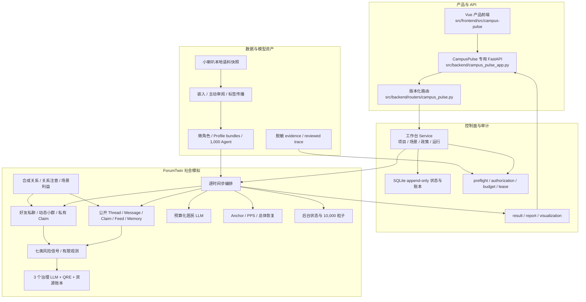
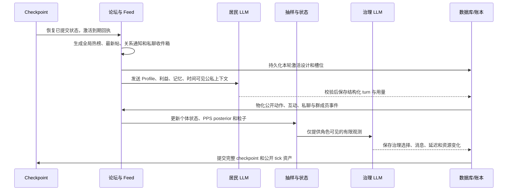
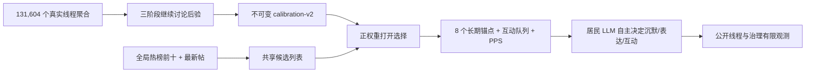

# 架构与代码地图

本文面向第一次修改 CampusPulse 的开发者，回答四个问题：系统分几层、一次模拟怎样完成、每个重要目录负责什么、要改某项功能应该从哪里进入。

## 1. 总体架构



依赖方向为：前端调用公开 API，API 调用项目服务，服务选择执行器，执行器调用 ForumTwin 内核。页面使用后端返回的运行记录。

## 2. 一次模拟怎样完成

### 2.1 创建与冻结


运行一旦冻结，模型、endpoint、Prompt renderer、人口、场景、预算和哈希不应在中途修改。修改任何一项都应创建新的 run/model release。

### 2.2 每个时间步（tick）

文档使用 `SCN-*` 标识场景、`RUN-*` 标识具体运行、`Tick N` 标识模拟时间步；`Tick` 是模拟世界的时间位置，不是实验编号。



普通后台模型负责阅读、注意力与私有状态推进；语言内容来自 LLM 输出或已保存的运行记录。

### 2.3 分支与结果

- 事件前的 baseline 只运行一次。
- 分支从同一个 checkpoint 复制人口、记忆和外生随机数。
- Natural 不新增治理动作；其他分支只因治理消息、服务对象及其后续 LLM 反应而变化。
- 结果同时保留公开论坛内容、严格机制链、聚合指标、Provider 用量和失败诊断。

## 3. 代码目录结构

```text
CampusPulse/
├─ src/
│  ├─ onesim/                         # 官方 YuLan-OneSim 基础运行框架
│  ├─ envs/
│  │  ├─ campus_pulse_governance/     # CampusPulse/ForumTwin 模拟内核
│  │  └─ rumor_spiral_governance/     # 另一治理场景扩展
│  ├─ backend/
│  │  ├─ campus_pulse/                # 工作台、运行时、存储和结果合同
│  │  ├─ routers/campus_pulse.py       # CampusPulse HTTP 路由
│  │  └─ campus_pulse_app.py          # 安全的专用 FastAPI 入口
│  └─ frontend/                       # Vue/Vite 前端
├─ scripts/
│  ├─ campus_pulse/                   # 数据准备、release、运行与打包
│  └─ run_forum_*.py                  # Hero/live/审计操作入口
├─ evidence/                          # 可提交的脱敏结果与审计证据
├─ specs/018-forumtwin-v2/            # 当前 ForumTwin 技术合同
├─ docs/                              # 面向使用者和开发者的产品文档
├─ docs/images/                      # 系统架构图
├─ _run/                              # 本机运行状态（默认不提交）
└─ START_*.cmd                        # Windows 启动入口
```

## 4. ForumTwin 模拟内核

| 文件/目录 | 作用 | 常见修改场景 |
|---|---|---|
| `forum_twin.py` | `ForumThread`、`ForumMessage`、`ForumClaim`、曝光和记忆领域对象；lineage、TTL、引用等基本约束 | 新增论坛对象字段或时序规则 |
| `forum_relationships.py` | 议题利益位置、2/4/2 合成关系、关系更新与公开聚合 release | 修改关系生成、利益特征或公开关系矩阵 |
| `forum_hero.py` | Natural/D Hero 的逐 tick 总编排、共享前缀、分支复制、激活队列、热榜/最新帖浏览池和治理承接地图 | 修改一次模拟的执行顺序、Feed 浏览或预算 |
| `forum_turns.py` | v1–v5 居民 Prompt；v5 把内部哈希、ID、原始粒子值和利益坐标留在审计层，只向 LLM 提供自然语言人物、经历、处境和短目标句柄；同时支持公开主动作、独立互动、好友私聊/动态群动作与实名/匿名表达 | 调整 Agent 输入输出合同 |
| `forum_v2_execution.py` | run-plan v9、三档激活、私聊 40% 调度、200 人 census、v3/v4 全量 Tick 两阶段提交与 result-v7 | 修改 v2 运行规模、抽样或全量提交 |
| `forum_visibility.py` | v10 可见性侧车；把 Profile 版本、关系注意、好友私聊、动态小群、服务工单和小喇叭匿名规则哈希绑定到 v9 主计划 | 修改项目交互通道或匿名规则 |
| `forum_risk.py` | 七类风险、冻结 baseline 阈值 release 和治理角色隐私保护投影 | 修改预警信号或有限观测 |
| `forum_realism.py` | 把公开模拟世界与全量语料的线程规模、回复功能和互动分布做聚合真实性对照 | 检查论坛生态偏差或比较新模型 release |
| `forum_persona_audit.py` | 私有收集 v5 发言当时的可见上下文和下一时间步状态，生成不含内部身份的四选一人物盲评包，并汇总人物一致性与文本—状态连续性 | 审查 LLM 是否真正使用人物、上下文和利益处境 |
| `forum_ecology_calibration.py` | 将全量真实线程的四档回复规模转换为三个可识别的继续讨论概率；可选后月留出和宏观角色部分池化 | 构建软 Feed 打开先验、验证隐私与 release 哈希 |
| `forum_expression.py` | LLM 表达调用与结构化结果处理 | 调整公开表达生成与格式修复 |
| `forum_execution.py` | 执行居民槽位，更新状态并物化公开消息 | 排查某条帖子为何出现或没有出现 |
| `forum_governance.py` | 三个治理角色的私有观测、Prompt 和动作合同 | 新增治理措施或修改角色观测 |
| `forum_actor_execution.py` | 治理 LLM、QRE 协调、资源账本、执行延迟和治理对象 | 修改治理决策与资源规则 |
| `forum_sampling.py` | 16 个纵向 Anchor、PPS 抽样、GREG/HT、Kish ESS 和 posterior 写回 | 修改预算化激活和总体恢复 |
| `forum_data.py` | 论坛数据编译与生态输入 | 接入新的语料 release |
| `forum_embedding.py` | 本地嵌入与语义相似度支持 | 更换本地 embedding 或索引策略 |
| `forum_quality.py` | 论坛质量、重复、承接和边界检查 | 新增内容质量门禁 |
| `forum_trace.py` | reviewed trace/cache 的结构和校验 | 精确重放或 trace 发布 |
| `llm_population.py` | 1,000 个可调用合成 LLM Agent 人口合同 | 修改 Profile/人口编译 |
| `governance_arena_v2.py` | 粒子、消息传播和动态治理博弈底层能力 | 研究更底层状态/博弈逻辑 |

## 5. 后端控制面

| 文件 | 作用 |
|---|---|
| `campus_pulse_app.py` | 只挂载 CampusPulse allow-list API；CORS、验证错误脱敏和默认 loopback 绑定 |
| `routers/campus_pulse.py` | 项目、证据、场景、政策、运行、结果、论坛和本机 Provider 配置路由 |
| `campus_pulse/service.py` | 工作台业务入口，协调 Store、release、运行器和报告 |
| `campus_pulse/store.py` | SQLite schema、append-only 记录、幂等、lease 与旧版本兼容 |
| `campus_pulse/runtime_worker.py` | 后台领取 run、执行、更新进度、取消与恢复 |
| `campus_pulse/forum_twin_contract.py` | run-plan-v8、result-v6 和论坛公开资产合同 |
| `campus_pulse/forum_twin_checkpoint.py` | 完整 checkpoint 编解码、哈希链和恢复 |
| `campus_pulse/forum_twin_persistence.py` | ForumTwin v12 持久化表与写入顺序 |
| `campus_pulse/forum_twin_round_coordinator.py` | 激活轮、slot、消息批和 checkpoint 原子协调 |
| `campus_pulse/forum_twin_v2_contract.py` | 工作台 run-plan v9 / result-v7 兼容包装，并校验可选的 v10 可见性侧车与父计划哈希 |
| `campus_pulse/forum_twin_v2_checkpoint.py` | Checkpoint v5；关系、私聊、群成员、风险和 census frontier |
| `campus_pulse/forum_twin_v2_persistence.py` | schema v13 的关系、私聊、风险与 census append-only 表 |
| `campus_pulse/forum_visibility_persistence.py` | schema v14 的项目 Profile 版本、v10 运行绑定、作者可见性、跨通道风险和 result-v8 append-only 表 |
| `campus_pulse/executors/forum_twin_v2.py` | 三档模式的零 Provider 工作量、进度、取消和恢复验证；不生成语言 |
| `campus_pulse/live_transport.py` | Provider 请求、已知失败/未知结果区分及零盲重试规则 |
| `campus_pulse/live_authorized_guard.py` | preflight 与单次授权绑定、请求/Token 上限 |
| `campus_pulse/live_asset_catalog.py` | reviewed live 资产发现、哈希和发布资格 |
| `campus_pulse/live_report_export.py` | 聚合 JSON/HTML 报告导出与发布门禁 |
| `campus_pulse/forum_live_vignette.py` | 工作台真实 LLM 控制面；按界面选择分派 118 槽快速闭环或 358 槽公域—私域主实验，生成 preflight、绑定一次性确认、启动 runner、轮询进度并从同一账本恢复；unknown 只接受一次 body-free、attempt 绑定的人工弃用与替代 |
| `campus_pulse/resource_private_channels.py` | 对住宿条件私聊/小群的公开聚合伴随结果执行 schema、SHA-256、隐私字段、Tick 完整性和计数守恒校验；不读取私聊正文 |
| `campus_pulse/provider_config.py` | 本机 Provider 公共配置与密钥分离存储；API 永不回显密钥 |
| `campus_pulse/translation.py` | 已公开合成文本的可选翻译；不处理原始私有语料 |

数据库 schema 采用 additive 演进：新版本新增表，不回填或修改旧版本运行。若修改 Store，必须同时验证旧 run-plan/result 读取。

## 6. 前端

| 路径 | 作用 |
|---|---|
| `src/campus-pulse/app/` | 产品 Shell、顶部导航、侧栏与响应式布局 |
| `src/campus-pulse/simulator/` | 模拟器首页与创建项目入口 |
| `src/campus-pulse/forum/` | 实时/回放论坛、热榜、最新帖、互动和治理对象 |
| `src/campus-pulse/live/` | 三个登记情景的公开进度读取、哈希校验与实时运行台 |
| `src/campus-pulse/results/` | 案例列表、趋势、机制链、治理和边界页面 |
| `src/campus-pulse/workbench/` | 项目、证据、场景、政策、计划、运行和报告工作台 |
| `src/campus-pulse/workbench/AgentWorldPanel.vue` | 物化全部 1,000 个 Agent 的长期世界、17 角色聚合关系网、逐 Tick 激活、10 粒子状态光环、项目利益位置与任意 Agent 档案入口 |
| `src/campus-pulse/workbench/WorkbenchRunMonitor.vue` | 真实运行状态，以及 v9+v10 激活模式、Profile 版本、公私通道、匿名、动作上限和两阶段提交合同 |
| `src/campus-pulse/workbench/ForumLiveVignettePanel.vue` | 真实 LLM 推演的情景与深度选择、预算预检、一次性确认、状态轮询、结果摘要、unknown 人工裁决和运行台入口 |
| `src/campus-pulse/results/ForumTwinV2DecisionPanel.vue` | result-v7/v8 的公私传播、作者可见性、跨通道风险、census 精度和关系消融结果 |
| `src/campus-pulse/results/ResourcePrivateChannelPanel.vue` | 住宿案例 Natural/D 的 Tick 4–10 私聊与群聊聚合、120 节点匿名关系投影、小群生命周期和治理证据穿透 |
| `src/campus-pulse/agent-world/ForumWorldRuntimeStage.vue` | 唯一可见的实时 Agent 世界组件；世纪馆、住宿、讲座和新项目运行监控都把运行数据归一为同一 frame，网络排在帖子之前，节点与边均可下钻 |
| `src/campus-pulse/agent-world/forumWorldRuntime.ts` | 统一 runtime frame 的节点、边、通道、证据和指标类型；公开回复、好友私聊、动态小群与治理传播使用明确通道 |
| `src/campus-pulse/agent-world/CaseAgentEvolution.vue` | 将住宿与讲座案例的公开 LLM 轨迹、严格 parent 回复及经校验私域聚合转换成统一 runtime frame |
| `src/campus-pulse/workbench/AgentWorldPanel.vue` | 固定 1,000-Agent 世界及激活调度；运行中读取服务端进度和已提交事件，转换成同一 runtime frame，不补造缺失帖子或私聊 |
| `src/campus-pulse/system/` | 就绪状态、证据目录、模型配置与系统边界 |
| `src/campus-pulse/api/http.ts` | API envelope、错误脱敏与 Axios 客户端 |
| `src/services/campusPulseApi.js` | 工作台 HTTP API 封装 |
| `src/services/forumTwin.ts` | sealed hero/result-v6 读取、哈希与隐私校验 |
| `src/services/forumTwinV2.ts` | result-v7/v8 的严格字段、SHA-256、隐私与 census/消融合同校验 |
| `src/services/resourcePrivateChannels.ts` | 在线 API 优先、离线精确字节哈希兜底的住宿私域聚合读取器；任一校验错误即失败关闭 |
| `src/services/forumAgentWorld.ts` | 统一 Agent 世界的 API 优先/离线兜底读取器；同时验证文件哈希、内部世界哈希、人口规模、代表节点数和隐私边界 |
| `src/views/` | 五个产品路由的页面组合 |
| `public/campus-pulse-data/` | 经审核、可公开、带哈希的离线案例资产 |

前端必须 fail closed：result、manifest 或 hash 不匹配时显示错误，不生成“好看的回退数据”。

## 7. 数据与运行脚本

| 路径 | 作用 |
|---|---|
| `scripts/campus_pulse/prepare_forum_twin_data.py` | 原始快照清点、清洗、去重和 thread 重建 |
| `run_forum_bge_embedding_worker.py` | 本地 BGE 批量嵌入和可恢复分片 |
| `build_forum_active_review_payloads.py` | 分层抽样并生成脱敏线程审阅载荷 |
| `run_forum_active_review.py` | 获授权后的主动语义审阅 |
| `apply_forum_active_review.py` | 审阅结果校验、合并和冲突处理 |
| `label_full_corpus_episodes.py` | 用全量 embedding 向审阅标签传播，形成 episode 池 |
| `compile_forum_twin_releases.py` | 微角色、Profile、人口与生态 release 编译 |
| `build_forum_twin_formal_release.py` | 绑定正式人口、模型和 preflight |
| `run_forum_hero_authorized.py` | 单 Hero live/trace 执行、账本和断点恢复 |
| `build_forum_resource_flagship_preflight.py` | 冻结资源分配五方案的最大运行合同；实际验证可在完整种子 checkpoint 上按成本边界停止 |
| `run_forum_resource_flagship_authorized.py` | 执行哈希绑定的资源分配主实验，保存槽位、消息和逐世界 checkpoint |
| `resume_forum_resource_flagship.py` | 对合同失败、明确 Provider 失败和 unknown 分别进行有界、证据化恢复 |
| `compile_resource_flagship_product_validation.py` | 从完整种子的哈希 checkpoint 零调用汇编产品验证结果，不修改原账本 |
| `analyze_resource_flagship_result.py` | 审计三种子产品验证或四种子完整结果，生成五方案均值、配对区间、人话报告和 SVG 故事图 |
| `publish_resource_flagship_evidence.py` | 门禁通过后发布脱敏结果、报告、故事图和 SHA-256 清单；不复制私有 ledger |
| `run_forum_twin_formal_authorized.py` | 双场景、多分支、多种子的正式编排入口 |
| `inspect_forum_hero_live_ledger.py` | 只读检查已结算、失败和 unknown 槽位 |
| `analyze_forum_parallel_result.py` | Natural/D 结果、严格承接与机制链审计 |
| `build_public_agent_decision_trace.py` | 从已提交公开账本生成“人物与历史 → 可确认上下文 → 操作 → 直接回应 → 后续行为”的单人轨迹 |
| `analyze_forum_resource_policy_result.py` | 资源分配案例专用结果报告 |
| `analyze_forum_ecology_fidelity.py` | 生成可复现的论坛生态真实性 JSON、门禁和人话报告 |
| `run_forum_four_dimension_structural_fixture.py` | 零网络跑通与正式 366 槽完全相同的 Natural/D 结构链；只验证编排、论坛生态、父 Agent 分化和治理承接，不作为 LLM 结果 |
| `score_forum_persona_audit.py` | 在本地把人工盲评答案与私有答案键、下一时间步状态合并，输出不含 Agent 身份的聚合人物结果 |
| `analyze_forum_four_dimensions.py` | 将同一次运行的论坛生态、人物、父 Agent 异质性和治理响应证据汇总成四维公共报告；缺证据保持 `pending` |
| `build_forum_persona_stage_a_preflight.py` | 冻结 12 人人物对照与 Natural/D 短闭环，共 99 个主槽；不读取密钥、不联网 |
| `run_forum_persona_stage_a_authorized.py` | 使用生产授权 transport、严格 JSON 合同、exact cache 和 checkpoint 执行 99 槽运行 |
| `resume_forum_persona_99_controlled.py` | 对已结算合同失败启用有界语义修复；unknown 仍须 attempt 级证据且自动网络重试保持为 0 |
| `analyze_persona_four_dimension_99.py` | 验证封存结果哈希并生成不含身份、Prompt、私聊正文或关系边的四维聚合 JSON |
| `publish_persona_four_dimension_99.py` | 从公共聚合生成中文结果说明、SVG 故事图和 SHA-256 清单 |
| `build_forum_ecology_calibration.py` | 从公开聚合 ecology 或私有 conflict-free episode 行生成 calibration-v2；全程零 Provider |
| `build_forum_twin_v2_relationship_releases.py` | 从正式 1,000-Agent 人口编译私有关系/利益和公开聚合 manifest |
| `build_forum_twin_v2_census_preflight.py` | 分层选择 200 人并冻结 603 槽 census preflight；零网络 |
| `run_forum_twin_v2_census_authorized.py` | 哈希授权后的 200 人 live runner、exact cache 和轮次 checkpoint |
| `analyze_forum_twin_v2_census.py` | 从有限总体重复模拟 B=16/24/32/48 并执行精度门禁 |
| `build_forum_twin_v2_ablation_preflight.py` | 仅在 census 通过后冻结 80 人四组消融 |
| `run_forum_twin_v2_ablation_authorized.py` | 四条件 Tick 3–8 的两阶段 live LLM 执行与恢复 |
| `analyze_forum_twin_v2_ablation.py` | 生成私有人工审阅包，并发布不含文本/ID 的聚合消融结果 |
| `build_forum_twin_v2_risk_threshold_release.py` | 从共享 baseline/冻结历史的聚合观测编译七类风险 q75/q95 阈值 release |
| `export_forum_agent_world_public.py` | 调用后端统一世界服务并导出 116 节点公开投影、内容哈希和 sidecar；不导出记录级私聊或关系边 |
| `compare_upstream.py` | 与固定官方 YuLan-OneSim main 快照生成逐文件差异表 |

完整数据流见 [DATA_PIPELINE.md](DATA_PIPELINE.md)。

### 7.1 生态校准后的 Feed 与激活链



`calibration-v2` 不改变 D 的排序；它只作用于 F。G 中未成为长期锚点的 Agent 仍有正 PPS 纳入概率。Dynamics 不参与 H 的文字生成。旧运行继续使用 16 锚点与原打开规则；只有 preflight 显式绑定 `ecology_calibrated_eight_anchor_v1` 和 calibration SHA-256 时才进入新链路。

## 8. 配置与安全边界

- `config/model_config.json`、`API.txt`、`*.api-key`、`provider-key` 均被 Git 忽略。
- 前端“模型配置”将密钥存到 `~/.campus-pulse/provider-key`，接口只返回“是否存在”，不返回值或尾号。
- Provider 配置路由仅允许 loopback 客户端；即使后端被显式绑定到局域网也拒绝远程密钥操作。
- live run 读取 preflight 与 authorization；格式/合同失败和明确 Provider 失败可按冻结次数受控修复，unknown 必须先写入 attempt 级裁决证据，不能盲目重发。
- 前端不会直接拼 runner 参数或管理 `v_n` 目录；prepare/start/status/resolve-unknown 四个 loopback API 负责生成 session、落盘授权、启动子进程、恢复 checkpoint 和发布逐 Tick 进度。
- `evidence/` 可以包含脱敏公开结果；`_run/` 是本地运行状态，不能自动视为发布证据。

## 9. 修改功能时的入口

| 目标 | 先读/改 | 至少运行 |
|---|---|---|
| 改居民 Prompt | `forum_turns.py`、`forum_execution.py` | `test_forum_turns.py`、Hero 小审计 |
| 改 Feed/论坛规则 | `forum_twin.py`、`forum_hero.py` | lineage、时间可见性、forum pilot 测试 |
| 改治理动作 | `forum_governance.py`、`forum_actor_execution.py` | actor 输入无 truth、资源守恒、严格承接测试 |
| 改抽样/预算 | `forum_sampling.py` | 固定预算、正纳入概率、可复现和 ESS 测试 |
| 改恢复 | checkpoint/persistence/round coordinator | 崩溃注入、最终 hash 和调用计数测试 |
| 改 API | router/service/store | `test_campus_pulse_api.py` 和旧版本兼容测试 |
| 改前端 | 对应 `campus-pulse/` 模块与 view | `npm run test:forum-twin`、`npm run build` |
| 改数据处理 | 对应 data-prep 脚本 | 行数、分片哈希、隐私扫描和 release 哈希 |

## 10. 产品合同

当前关系传播、私聊与风险治理合同定义在 `specs/018-forumtwin-v2/TECHNICAL_SPEC.md`。产品操作以 README 和用户手册为入口；实验结果与复现方式统一收录在 `EXPERIMENT_REPORT.md`。
