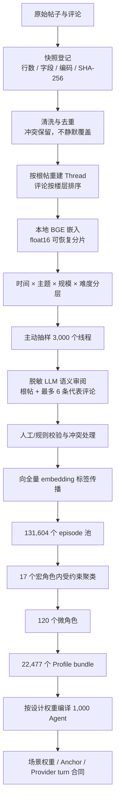
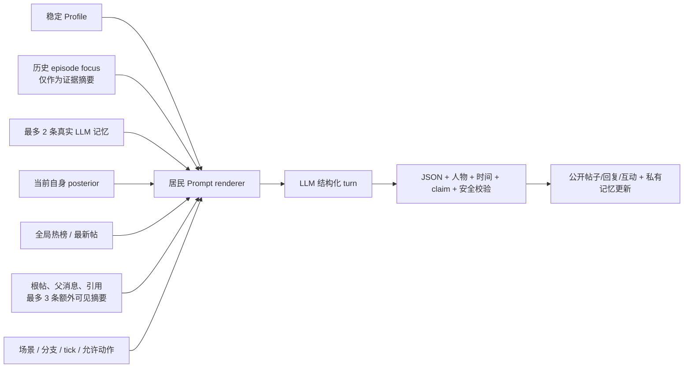
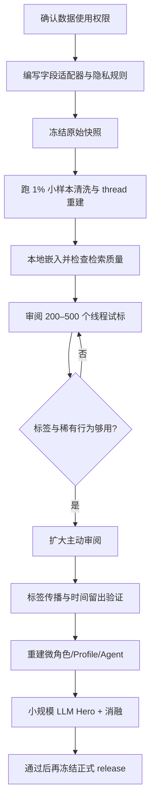

# 小喇叭数据如何变成可模拟的 Agent

本文说明由 RUC 小喇叭论坛直接得到的数据，如何一步步变成 ForumTwin 能使用的论坛生态、微角色、Profile 和合成 Agent；最后给出迁移到其他论坛的条件与操作清单。

## 1. 原始数据是什么

冻结语料快照的审计规模为：

- 132,917 条帖子；
- 454,053 条评论；
- 时间覆盖 2022-11 至 2026-07；
- 清洗后进入嵌入流程的语义行 582,408 条；
- 3,000 个线程经过主动语义审阅；
- 标签传播后形成 131,604 个冲突自由 episode；
- 编译得到 120 个微角色、22,477 个 Profile bundle 和 1,000 个合成 LLM Agent。

原始正文、帖子/评论源 ID、联系方式和私有路径只在受控数据准备环境处理，不进入 Git、公开 API、日志、结果或比赛包。

这里的 **episode** 是一段可审阅的论坛行为情境，例如“根帖提出场地预约疑问，评论者要求给出复现时段”。它不是一个真实用户，也不用于重建用户长期身份。

## 2. 端到端数据流

## 3. 每一步具体做什么

### 3.1 快照登记

入口：`scripts/campus_pulse/prepare_forum_twin_data.py`

记录每个输入文件的：绝对来源只保留在私有操作记录中；公开 release 只保留文件角色、字节数、SHA-256、字段、编码、行数、最早/最晚日期和收集制度。若同名文件哈希变化，创建新 snapshot release，不覆盖旧快照。

这样可以回答“这个人口究竟来自哪一版数据”，也能避免不同同学拿不同导出文件却以为结果可比。

### 3.2 清洗、去重和 thread 重建

- 帖子用私有 `post_code + content_hash` 去重；
- 评论用私有 `post_code + comment_id + content_hash` 去重；
- 同 ID、不同正文作为冲突记录进入复核，不静默覆盖；
- 评论按 `floor` 排序并绑定根帖；
- 没有真实评论时间时，不从楼层或帖子日期推断回复延迟；
- 已知抓取缺口和收集制度改变以字段标记，避免把采集变化解释成社会变化。

输出是私有 thread 表和只含哈希/统计的 corpus snapshot release。

### 3.3 本地语义嵌入

入口：`scripts/campus_pulse/run_forum_bge_embedding_worker.py`

使用冻结版本的 `BAAI/bge-small-zh-v1.5`，把帖子和评论编码为 512 维向量。向量按 float16 分片保存，分片有行范围、模型 revision、配置和 SHA-256，支持断点与重复运行校验。

为什么在本地做：586,970 条原始记录不应全部发送给第三方；嵌入用于聚类、相似检索和主动抽样，不需要外部 Provider 看到原文。

### 3.4 主动语义审阅

入口：

- `build_forum_active_review_payloads.py`：抽样与脱敏载荷；
- `run_forum_active_review.py`：获授权后调用；
- `apply_forum_active_review.py`：严格校验、合并和复核。

主动审阅覆盖时间、主题、线程规模、语言难度、回复功能、稀有簇和漂移区域。每个调用最多包含一个脱敏线程：根帖和 6 条代表评论。语义卡标注：

- 主题与需求；
- speech act；
- 回复功能（赞同、追问、反驳、纠错、共情、玩笑、经验分享、求证、求助、风险上报等）；
- stance、risk、evidence status、emotion；
- 语言形式、信息密度和 thread position。

审阅失败不会被当作“无标签”；它会重试受控格式修复或保留为明确失败。

### 3.5 从审阅样本扩展到全量 episode

入口：`label_full_corpus_episodes.py` 和 `build_forum_twin_episodes.py`

利用本地 embedding，把 3,000 个已审线程的结构化标签传播到语义相近且置信度达标的全量线程。冲突、低置信度和越界记录不进入正式 episode 池。输出 131,604 条冲突自由 episode，每条只保留脱敏语义特征和指纹，不保留原始正文或源 ID。

这一步不是让模型“猜所有帖子标签”后无条件采纳；它必须保留距离、置信度、来源审阅簇和拒绝原因，才能审计覆盖与漂移。

### 3.6 微角色与 Profile bundle

入口：`compile_forum_twin_releases.py`、`build_forum_twin_formal_release.py`

17 个宏角色只作为产品导航，例如信息求证者、服务需求者、桥接者；它们不够表达真实论坛异质性。因此系统在每个宏角色内部按行为和语义特征做受约束聚类，得到 120 个微角色。

一个 Profile bundle 包含：

- 主/次宏角色和微交互角色；
- 稳定的 topic/need portfolio；
- 发帖、回复、潜水、纠错、桥接、求助倾向；
- 对证据、权威和同伴的接受方式；
- 不确定性处理、语言风格、回复功能和信息密度；
- 活动节律、注意力预算、记忆种子与安全边界；
- 3–5 个脱敏语义证据指纹。

**稳定人格与 episode focus 分离**：Profile 描述长期机制；某一条 episode 只提供一段历史情境。Prompt 编译器不会把历史帖内容直接写入当前回答，Profile bundle 的异质性门禁也限制模板复制。

### 3.7 编译 1,000 个合成 Agent

每个 Agent 从 Profile bundle、episode 证据和设计权重构造：

- 使用新生成的合成 `agent_id`，不保留源 ID；
- 拥有独立状态、真实 LLM 记忆、消息收件箱和 Provider turn 合同；
- 同一人口用于平行分支，分支从同一 checkpoint 复制；
- 10 个状态粒子表达这个 Agent 的不确定性，不增加人数；
- 16 个 Anchor 用于纵向轨迹，PPS 样本用于预算化总体估计。

最终 release 必须通过人口权重、Profile 熵、完全重复比例、证据匹配、fallback、敏感字段和 Prompt 渲染检查。

## 4. 数据对象如何进入一次 Prompt

Prompt 明确禁止原始论坛正文、源 ID、真实身份、隐藏总体真值、未来信息、目标结果份额、路径和凭据。

## 5. 哪些数据可以提交，哪些不能

| 数据 | 可否进 Git/公开包 | 原因 |
|---|---|---|
| 原始帖子/评论正文 | 否 | 私有语料与潜在个人信息 |
| 源帖子/评论 ID | 否 | 可能反向定位记录 |
| 全量 embedding 分片 | 否 | 私有派生索引、体积大且可被反推 |
| corpus 行数、时间、哈希 | 是 | 只用于数据谱系审计 |
| 脱敏语义 episode/release | 条件允许 | 必须通过敏感字段扫描和人工审阅 |
| Profile bundle | 条件允许 | 不含真实身份、原文和源映射时可发布 |
| 合成 Agent display profile | 是 | 只展示合成身份和公开行为特征 |
| 公开 LLM 论坛结果 | 条件允许 | 只限校验后的合成内容和 provenance |
| API Key、Provider 原始 body | 否 | 凭据与非公开服务数据 |

## 6. 能否复用到其他论坛

可以，但不是“换一个 CSV 路径就完成”。可复用部分与必须重做部分如下：

### 可直接复用

- snapshot、哈希、分片和幂等框架；
- thread/message/claim 标准对象；
- 本地 embedding worker；
- 主动学习的分层、稀有簇和不确定性抽样；
- 语义卡 JSON 合同的大部分字段；
- 微角色/Profile 编译框架；
- 隐私扫描、权重检查、Prompt clone 检查；
- ForumTwin 运行、抽样、治理、checkpoint 和结果合同。

### 必须针对新论坛适配

1. **字段映射**：根帖 ID、父子关系、楼层、时间、板块、互动计数。
2. **产品机制**：是按时间、热榜、关注关系还是个性化推荐；不能把小喇叭的“热榜 + 最新”强套给别的平台。
3. **收集制度**：抓取缺口、规则变化、删帖和匿名机制。
4. **语言与标签**：方言、表情、平台黑话、稀有行为和风险边界。
5. **宏角色命名**：17 个校园宏角色不一定适用于其他社区。
6. **隐私评审**：新论坛的授权、个人信息、敏感群体和发布边界。
7. **生态校准**：线程规模、回复功能、主题熵、纠错比例等必须重新在留出时间段验证。

## 7. 迁移到新论坛的标准步骤

推荐先运行 1% 数据和 200–500 线程，不要一开始就全量调用 Provider。只有标签覆盖、隐私边界和论坛机制验证后，才扩大审阅与正式人口。

## 8. 完成标准

一个“可模拟数据 release”至少要提供：

- 原始 snapshot 的行数、字段、日期、字节和 SHA-256；
- 去重、冲突、缺失和采集制度报告；
- embedding 模型/版本/分片和完整性；
- 审阅样本选择概率、覆盖与失败记录；
- 全量标签传播的置信度和拒绝规则；
- 微角色/Profile 数量、熵、重复率和证据匹配率；
- 1,000 Agent 权重与 Prompt 渲染检查；
- 敏感字段扫描零命中；
- 一个小规模论坛运行证明 Profile、上下文和平台机制真的进入行为。

只有文件存在而没有这些谱系与门禁，不能称为可复用的数据管线。
